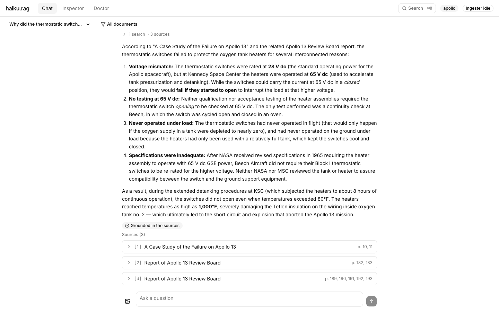
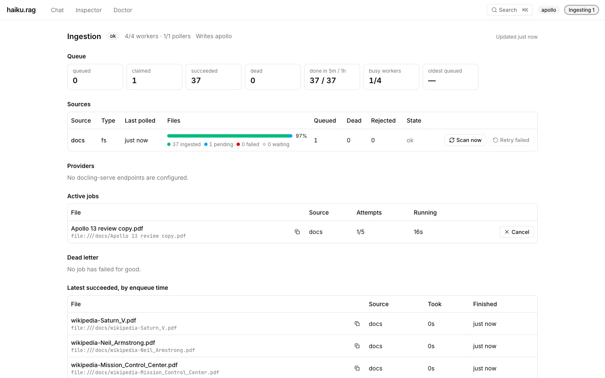
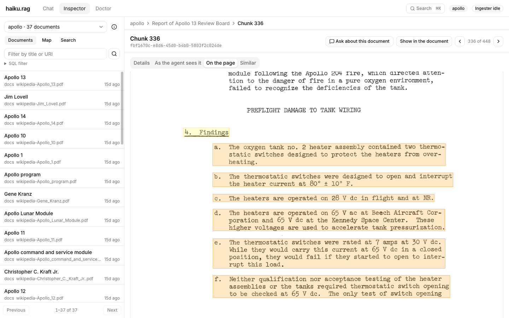
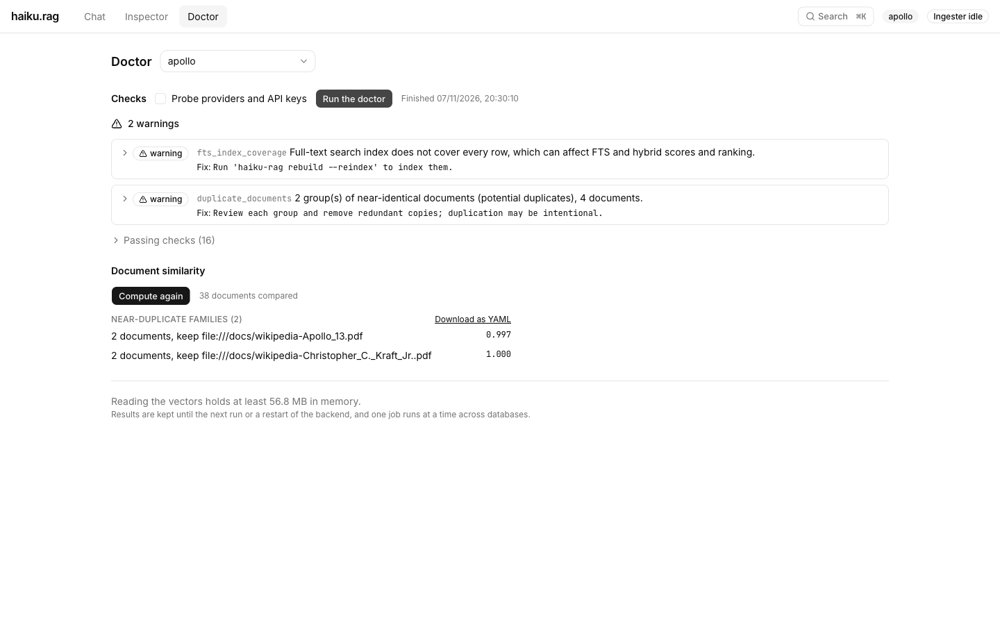

# Web app

The web app is a browser interface to a haiku.rag knowledge base. In it you ask questions and check each answer against its cited passages, follow the ingester as it adds the documents you copy into a folder, inspect documents and their chunks, and run health checks.



!!! warning "No authentication"
    The app has no authentication, and the frontend adds `INGESTER_TOKEN` to every request it forwards to the ingester. Anyone who reaches the frontend reads every configured database and can refresh the ingester's sources, retry or cancel its jobs, and edit or delete documents. The Compose files publish the ports on `127.0.0.1` only. To serve the app beyond the local machine, put the frontend behind a reverse proxy that authenticates users.

## Set it up

The app runs with Docker Compose from the `app/` directory of the repository, on published images: `ghcr.io/ggozad/haiku.rag-app-backend`, `ghcr.io/ggozad/haiku.rag-app-frontend` and `ghcr.io/ggozad/haiku.rag-slim` for the ingester. Releases from 0.105.0 publish them. Copy the two example files:

```bash
cd app
cp .env.example .env
cp config/haiku.rag.yaml.example config/haiku.rag.yaml
```

`.env` contains the API keys and three directories on your machine: `CONFIG_DIR` for the configuration (default `./config`), `DATA_DIR` for the databases (default `./data`) and `DOCS_VOLUME` for the documents to ingest (default `./docs`). It also contains `INGESTER_TOKEN`, a secret that the frontend sends to the ingester. Both the backend and the ingester require it.

`config/haiku.rag.yaml` is a haiku.rag [configuration](configuration/index.md): the models, the databases and the ingester's source. The example expects Ollama with `gpt-oss` and `qwen3-embedding:4b`, and converts documents on the `docling-serve` service. It places the database `haiku.rag` at `/data/haiku.rag.lancedb`, inside `DATA_DIR`.

Edit both files for your paths, token and models. Then start the app and open `http://localhost:3000`:

```bash
docker compose up -d
```

Four services run: a backend that reads the databases, the [ingester](ingester.md), which writes them, docling-serve, which converts documents for the ingester, and the frontend.

The compose file names the images of its own release. `HAIKU_RAG_VERSION` in `.env` selects another release for all three. The backend opens a database only when its haiku.rag version supports the database's schema, so keep the backend and the ingester on one release.

To build the images from the checkout instead, use the development compose file, which also reloads the backend's code on change:

```bash
docker compose -f docker-compose.dev.yml up -d --build
```

### Add databases

Every database lives in `DATA_DIR`, mounted at `/data`, so a new one needs no new mount. A database on object storage (`s3://…`) needs no mount at all. Add one as a [database fragment](configuration/index.md#database-fragments) in `config/databases/`, for example `config/databases/papers.yaml`:

```yaml
lancedb:
  databases:
    papers: /data/papers.lancedb

ingester:
  databases:
    papers:
      sources:
        - type: fs
          id: papers
          root: /docs/papers
```

Then reload the ingester and the backend. Both read the configuration directory again:

```bash
curl -X POST -H "Authorization: Bearer $INGESTER_TOKEN" http://localhost:8765/reload
curl -X POST http://localhost:8001/reload
```

Chat searches every database, and the inspector and the doctor show one at a time. The ingester writes each database listed under `ingester.databases`, from the sources listed with it (see [Configure sources](ingester.md#configure-sources) and [Multiple databases](configuration/multiple-databases.md)).

The backend's reload applies `lancedb.databases` only. It answers 409 and names the sections when another one changed, since those need a restart, and ignores the `ingester` section. A chat turn whose session selects documents of a removed database fails and names that database.

### Deployment limits

- One backend covers databases that share one `embeddings` configuration. The backend embeds every query with that configuration. A database embedded at another vector dimension fails to open. One embedded by another model at the same dimension opens with a warning, and its search results are meaningless. Run a separate app for databases with a different embedder.
- The backend runs as one replica with one worker. It holds runs in process and stores sessions in a SQLite file.

### Telemetry

With `LOGFIRE_TOKEN` set, the backend sends spans to Logfire with `service.name` `haiku-rag-app`, or the value of `OTEL_SERVICE_NAME`. Every HTTP request is a span, and a chat run's agent and model spans nest under its request. Each doctor run and similarity job is an `app.job` span with `kind` (`doctor` or `similarity`) and `database`, nested under the request that started it. A job that fails records its exception on that span. A similarity job whose result cannot be built records an `app.job result failed` exception under the request instead.

### Serve under a URL prefix

The frontend serves at the root of its origin unless it is built with `BASE_PATH`, a prefix such as `/rag`. The prefix is fixed when the frontend image is built, and the published frontend image serves at the root. To serve the app under a prefix, build the frontend image yourself and keep the published backend and ingester images, which never see the prefix. Changing the prefix means building the frontend image again. Setting `BASE_PATH` on a built image moves only its health check, so the container reports unhealthy.

From `app/`:

```bash
docker build --build-arg BASE_PATH=/rag -t haiku-rag-app-frontend:rag frontend
```

Point the frontend service at that image in `docker-compose.override.yml`, which `docker compose` reads beside `docker-compose.yml`:

```yaml
services:
  frontend:
    image: haiku-rag-app-frontend:rag
```

The proxy passes the prefix through, since the frontend expects it in every path. The chat streams its answers, so turn off response buffering, or each answer arrives all at once. The stream also stays silent while the model thinks or a tool runs, so raise the read timeout above the longest pause: nginx closes the stream after 60 s by default. With nginx:

```nginx
location = /rag {
    proxy_pass http://127.0.0.1:3000;
    proxy_buffering off;
    proxy_read_timeout 10m;
}

location /rag/ {
    proxy_pass http://127.0.0.1:3000;
    proxy_buffering off;
    proxy_read_timeout 10m;
}
```

The frontend redirects `/rag/` to `/rag`. Don't redirect `/rag` to `/rag/` at the proxy: the two redirects loop.

With the development compose file, the prefix needs no build: set `BASE_PATH` in `.env`, and `docker compose -f docker-compose.dev.yml up -d` recreates the frontend with it. Behind a proxy, the development server's pages wait for its live-reload WebSocket, so forward WebSocket upgrades too:

```nginx
    proxy_http_version 1.1;
    proxy_set_header Upgrade $http_upgrade;
    proxy_set_header Connection "upgrade";
```

### Upgrade from an earlier layout

Before 0.105.0, the compose files built the images, mounted `app/haiku.rag.yaml` as one file, and mounted the database itself at `/data` from `DB_VOLUME`. To move to this layout:

1. Move `app/haiku.rag.yaml` to `app/config/haiku.rag.yaml`.
2. If you set `DB_VOLUME`, set `DATA_DIR` to its parent directory. The default `./data/haiku.rag.lancedb` needs nothing.
3. In `haiku.rag.yaml`, place `haiku.rag` at `/data/` followed by the name of the directory `DB_VOLUME` named, instead of `/data`. With the default, that is `/data/haiku.rag.lancedb`.
4. For the published images, set `processing.converter` and `processing.chunker` to `docling-serve` and `providers.docling_serve.base_url` to `http://docling-serve:5001`, as the example does. The published ingester image has no local docling.
5. To add databases as fragments in `config/databases/`, add `databases_include: databases` to `haiku.rag.yaml`. Without it, the services ignore the fragments.

Check step 3 before the first start. With `haiku.rag` left at `/data`, the ingester creates an empty database directly in `DATA_DIR` and ingests every document into it again. The app then shows only that copy, and table directories such as `documents.lance` and `chunks.lance` appear directly in `DATA_DIR`. The original database stays in `haiku.rag.lancedb`. To return to it, stop the app, fix the location, remove the `*.lance` directories at the top of `DATA_DIR` and nothing inside `haiku.rag.lancedb`, and start the app again.

The backend runs as uid 1001. A `sessions` volume created by a backend that ran as root holds a root-owned session file, and saving a session fails until you change its owner once:

```bash
docker compose run --rm --user root backend chown -R 1001:1001 /sessions
```

## Ask questions

Type a question in Chat and press Enter. Shift+Enter starts a new line, and the stop button ends an answer early. The agent's steps show while it works: its searches, and any program it wrote to count or compare across documents. Once the answer starts, they fold into one line that counts them. Click the line to open them, or its source count to reach the sources. Below the answer, a badge says whether the answer is grounded in its sources, and the sources follow.

Open a source to read the cited passage. For a document with page images, such as a PDF, "View in document" shows the passage highlighted on its pages, scanned pages included. "Open in the inspector" opens the passage's chunk in a new tab. A document whose metadata carries an http(s) `url` gets a link to it, named by its host.

To ask about particular documents, choose them with the "All documents" filter above the conversation. With a vision model (`qa.model.vision: true`), a question can carry images: pick, paste or drop them into the box.

The server keeps every conversation. The menu at the top left starts a new one, switches between them, renames, exports one as Markdown, and deletes.

## Add documents

Copy files into the `DOCS_VOLUME` folder. The ingester converts, chunks and embeds each one. The app finds a document at most 30 seconds after the ingester finishes it, the default of `lancedb.read_consistency_interval_seconds`. The ingester updates a document when its file changes, and deletes it when the file is removed.

The chip at the top right shows the ingester's state: idle, ingesting, holding failed jobs, degraded, or unreachable. Click it for the ingestion page. It shows each configured database that is not running with its error, the queue, each source with any error from its last scan, the jobs running now and the ones that failed, with buttons to retry a failed job, cancel one, rescan a source, or retry every dead job of a source. Each source's bar shows its files by state: ingested, pending, failed and waiting for the next scan, with the share ingested. A job shows its file name over its URI, and the button beside it copies the URI. Click a job for its details.



## Inspect documents and chunks

The Inspector lists the documents of a database, filtered by title or URI, or by a SQL filter on the documents. Open one to read its converted text, and to see its outline, chunks, pages and pictures. Its header shows the short fields of its metadata and links its `url` when that is an http(s) address. All metadata is one click away.

The agent searches and cites chunks, short passages of a document. A chunk's page shows its text, what the agent receives when a search returns it, its place on the original page, and the most similar chunks. It is the place to look when an answer cites the wrong passage or misses one.

An audio or video document has no pages. Its chunks, search results, citations and video frames show their time in the recording, as `00:12:03-00:12:41`.



When the ingester writes the database, Edit on a document sets its title and your own metadata, kept under `metadata.user` (see [Editor metadata](python.md#editor-metadata)). A value marked JSON is stored as JSON, any other as text. A source re-ingest keeps both. Delete removes a document without a `source_id`, with its attachments. Delete is disabled on a source-owned document, which is removed from the source instead, and on a PDF attachment, and its tooltip says why. The ingester makes both changes, so neither is offered on a database read at a tag or on one outside `ingester.databases`. The header shows the editor metadata under the title. The inspector reads the change after up to `lancedb.read_consistency_interval_seconds` (30 by default): until then, reopening the document shows its earlier state and the list still shows a deleted document.

"Similar documents" on a document lists the ten documents nearest it by the average of their chunk embeddings, each a link to its page. "Compute similarity" there or on the doctor page compares every document, and "Compute again" refreshes the comparison after new documents arrive.

The Search tab, or Ctrl+K (Cmd+K on a Mac) from any page, searches every database, by text or, with a multimodal embedder, by image. Each inspector page has its own address, so Back returns to the previous view and a link reopens the same one. "Ask about this document" starts a conversation limited to the open document.

## Check its health

The Doctor checks one database: its tables and indexes, its embeddings against the configured embedder, and the providers it calls. Its similarity job finds documents that are near-duplicates of each other. Choose the database and press "Run the doctor". The report opens with its verdict, then the failures and warnings, each naming its fix. The passing checks fold into one line. The checks and the similarity job run in the background. The similarity job lists the near-duplicate families, each with the document to keep, and exports them as YAML. Before either starts, the page shows a lower bound on the memory for the chunk vectors, when the database's size is available.



## For developers

The app's architecture, its API and its tests are described in [`app/README.md`](https://github.com/ggozad/haiku.rag/tree/main/app).
