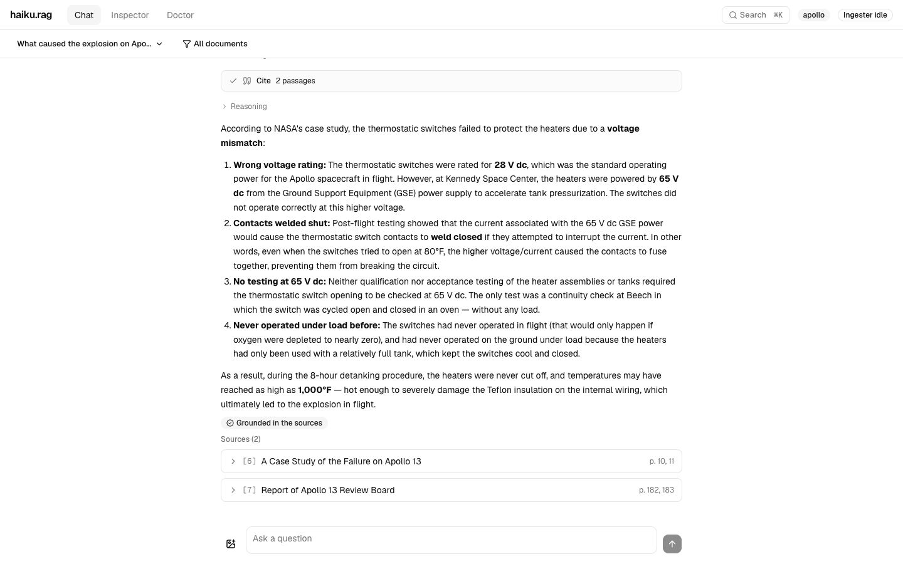
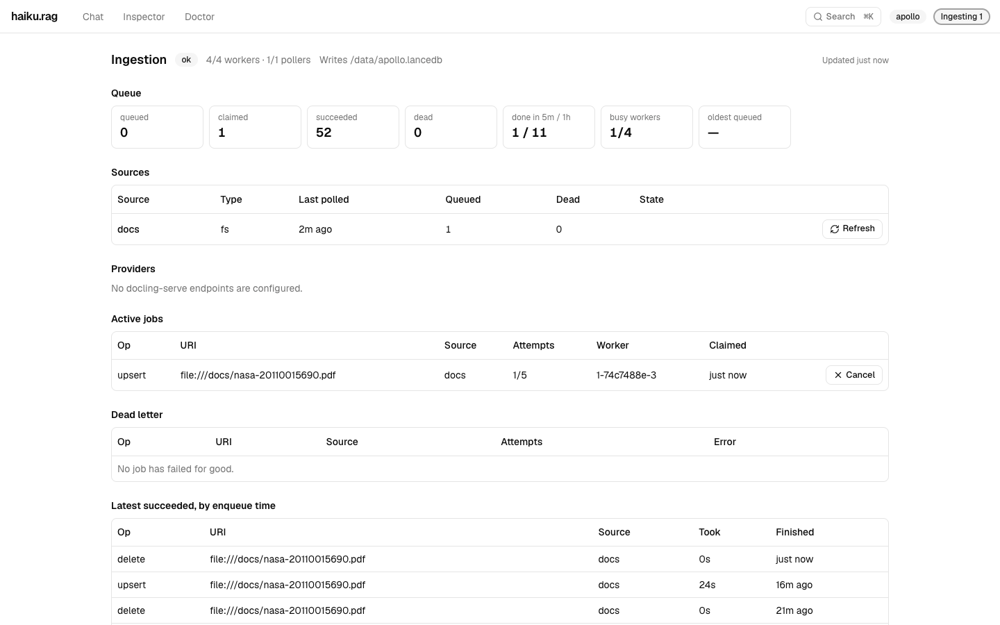
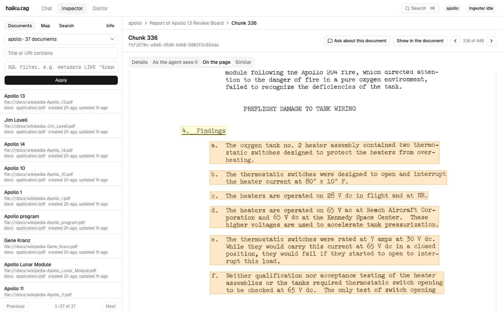
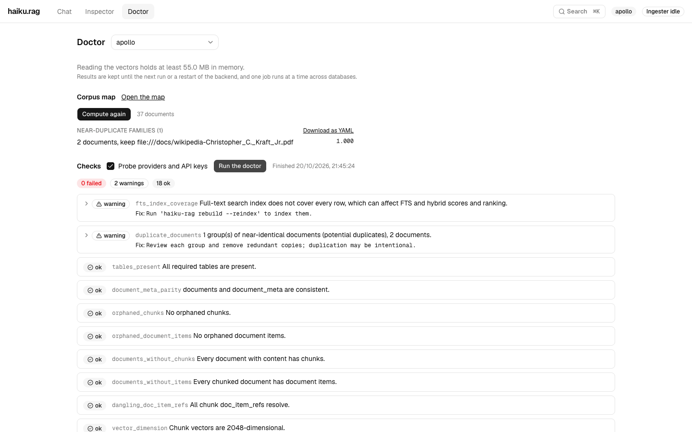

# Web app

The web app is a browser interface to a haiku.rag knowledge base. In it you ask questions and check each answer against its cited passages, follow the ingester as it adds the documents you copy into a folder, inspect documents and their chunks, and run health checks.



!!! warning "No authentication"
    The app has no authentication. The Compose files publish its ports on `127.0.0.1` only. Keep them unreachable from untrusted networks.

## Set it up

The app runs with Docker Compose from the `app/` directory of the repository. Copy the two example files:

```bash
cd app
cp .env.example .env
cp haiku.rag.yaml.example haiku.rag.yaml
```

`.env` contains the API keys and two paths on your machine: `DB_VOLUME` for the database and `DOCS_VOLUME` for the documents to ingest. It also contains `INGESTER_TOKEN`, a secret that the frontend sends to the ingester. Both the backend and the ingester require it.

`haiku.rag.yaml` is a haiku.rag [configuration](configuration/index.md): the models, the database and the ingester's source. The example expects Ollama with `gpt-oss` and `qwen3-embedding:4b`.

Edit both files for your paths, token and models. Then start the app and open `http://localhost:3000`:

```bash
docker compose up -d --build
```

Three services run: a backend that reads the database, the [ingester](ingester.md), which writes it, and the frontend.

To work across several databases, list them under `lancedb.databases` (see [Multiple databases](configuration/multiple-databases.md)). Chat searches all of them, and the inspector and the doctor show one at a time. The ingester writes one of them: add `--db` with that database's path inside the container to the `ingester` service's command.

## Ask questions

Type a question in Chat and press Enter. Shift+Enter starts a new line, and the stop button ends an answer early. The answer streams in with the agent's steps: its searches, and any program it wrote to count or compare across documents. Below the answer, a badge says whether the answer is grounded in its sources, and the sources follow.

Open a source to read the cited passage. For a document with page images, such as a PDF, "View in document" shows the passage highlighted on its pages, scanned pages included. "Open in the inspector" opens the passage's chunk in a new tab.

To ask about particular documents, choose them with the "All documents" filter above the conversation. With a vision model (`qa.model.vision: true`), a question can carry images: pick, paste or drop them into the box.

The server keeps every conversation. The menu at the top left starts a new one, switches between them, renames, exports one as Markdown, and deletes.

## Add documents

Copy files into the `DOCS_VOLUME` folder. The ingester converts, chunks and embeds each one, and the document is searchable as soon as it finishes. The ingester updates a document when its file changes, and deletes it when the file is removed.

The chip at the top right shows the ingester's state: idle, ingesting, holding failed jobs, degraded, or unreachable. Click it for the ingestion page. It shows the queue, each source, the jobs running now and the ones that failed, with buttons to retry a failed job, cancel one, or rescan a source.



## Inspect documents and chunks

The Inspector lists the documents of a database. Open one to read its converted text, and to see its outline, chunks, pages and pictures.

The agent searches and cites chunks, short passages of a document. A chunk's page shows its text, what the agent receives when a search returns it, its place on the original page, and the most similar chunks. It is the place to look when an answer cites the wrong passage or misses one.



The Map tab places documents near others about similar things. "Compute the map" builds it, and "Compute again" refreshes it after new documents arrive. Select a document to list its nearest neighbours.

Ctrl+K, or Cmd+K on a Mac, searches from any page, by text or, with a multimodal embedder, by image. Each inspector page has its own address, so Back returns to the previous view and a link reopens the same one. "Ask about this document" starts a conversation limited to the open document.

## Check its health

The Doctor checks one database: its tables and indexes, its embeddings against the configured embedder, the providers it calls, and documents that are near-duplicates of each other. Choose the database and press "Run the doctor". Each warning names its fix. The checks and the map run in the background. Before either starts, the page shows a lower bound on the memory for the chunk vectors, when the database's size is available.



## For developers

The app's architecture, its API and its tests are described in [`app/README.md`](https://github.com/ggozad/haiku.rag/tree/main/app).
