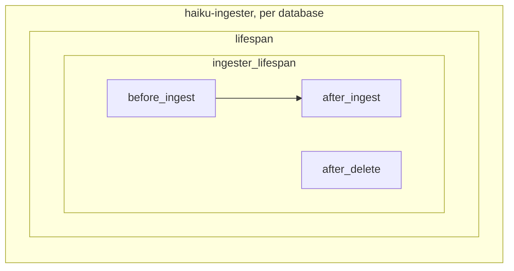
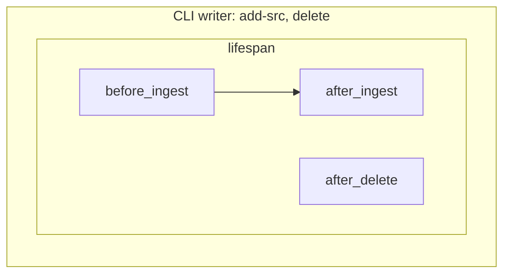
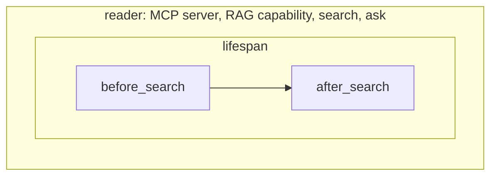

# Hooks

Hooks let external packages transform or refuse documents before ingestion, observe document writes and transform searches without forking haiku.rag. Use them for cleaning documents, query rewriting, result annotation, or maintaining state derived from the corpus (a synonym table, an entity index, corpus statistics).

A hook is a class registered under the `haiku.rag.hooks` entry-point group and activated by name in config. Hooks run everywhere the client runs: CLI, MCP server, RAG capability, and your own code.

A hook is behaviour for the whole process. It can transform, reject or observe any document or search that passes through the client. Metadata for one source belongs in that source's [metadata provider](ingester.md#metadata-providers). The source's configuration names it, and an ingester reload changes it. The ingester's reload refuses a change to `hooks`, which needs a restart.

## Hook points

Subclass `haiku.rag.hooks.Hook` and override any subset:

| Method | Fires | Use for |
|--------|-------|---------|
| `before_ingest(client, request)` | A source document was fetched, before conversion. Also each PDF attachment | Rewriting bytes, adding metadata |
| `after_ingest(client, event)` | Document content was written (create, import, batch import, update). Also each PDF attachment, before the PDF's own event | Deriving state from documents |
| `after_delete(client, event)` | Documents were deleted, including attachments a re-ingested PDF no longer carries | Cleaning up derived state |
| `before_search(client, request)` | Before retrieval, text queries only | Query expansion, filter injection |
| `after_search(client, request, results)` | After retrieval, reranking, and deduplication | Annotating, reordering, or filtering results |
| `lifespan(client)` | Around the whole client lifetime | Owning connections and clients |
| `ingester_lifespan(client)` | Around the time haiku-ingester ingests into the client's database | Background tasks |

Events are batch shaped. `IngestEvent` carries `documents` (a batch import arrives as one event with the whole batch) and `operation` (`"create"` or `"update"`). `DeleteEvent` carries the deleted `documents` in their last-known state, since the rows are already gone; a cascade arrives as one event. `SearchRequest` carries `query`, `filter`, `search_type`, and `limit`. `before_search` returns the request to search with, and may modify any of its fields. The query feeds both the vector and the full-text side. `after_search` returns the result list, and reads a request whose `search_type` is the one retrieval actually used: `hybrid` where a text search left it unset, `vector` for an image query. Hooks run in the order listed in config, each receiving the previous hook's output.

Hooks receive the `HaikuRAG` client, so they can search, read repositories, and store their own state.

Each box runs inside the one around it. A lifespan enters before the first hook point inside it and exits after the last. A hook point fires only when its event happens: `after_ingest` when content is written, `after_delete` when documents are deleted, `before_search` for a text query.







## Transforming documents before ingestion

`before_ingest` runs for every document ingested from a source (`create_document_from_source`, `add-src`, the ingester) and for every PDF attachment with a supported extension. `IngestRequest` carries `uri`, `source_id`, `body`, `content_type`, and `metadata`. A hook may replace `body` and add keys to `metadata`, which starts empty, and returns the request. `uri` is the URI the document is stored under: the `uri` given to `create_document_from_source`, else the source as given, with a local path made absolute and its symlinks kept. A hook reads the stored document, if there is one, with `client.get_document_by_uri(request.uri)`. `source_id` is the ingesting source, an attachment's parent's included. An ad-hoc ingest passes the source recorded on the stored document, and `None` when there is none. An attachment's `uri` is `<parent uri>#attachment=<name>`, with the name URL-quoted.

```python
class StripBoilerplateHook(Hook):
    async def before_ingest(self, client, request):
        if request.content_type == "text/markdown":
            request.body = strip_boilerplate(request.body)
            request.metadata["cleaned"] = True
        return request
```

- `before_ingest` runs on every fetch, before the unchanged-bytes check, so it also runs for bytes that have not changed: a file whose modification time moved, an object uploaded again with the same bytes, an `add-src` re-run of a document stored without a `source_revision`.
- The stored `md5` is that of the body the hook returns, and `source_revision` stays the source's. An unchanged source file that transforms to the same bytes is not re-ingested.
- Keys a hook adds win over a metadata provider's and over the source's own metadata. The keys ingestion owns (`content_type`, `md5`, `source_revision`, `source_id`, `parent_uri`) are dropped. Any other value that is not JSON-serialisable fails the ingest as a `HookError` before conversion. A metadata provider receives the fetched bytes, never the hook's.
- Raising `DocumentRejected(reason)` refuses the document. Nothing is written, and a stored copy stays. A hook that wants a stored standalone document gone deletes it through the client before raising. A stored attachment cannot be deleted on its own while its PDF is stored: `delete_document` raises `AttachmentDeletionError`, which fails the PDF's ingest as a `HookError`. Ingesting one document raises the exception with `uri` set, reading `<uri> rejected: <reason>`. A directory `add-src` logs that message as a warning and goes on to the next file, and a PDF's attachments skip a rejected one the same way. The ingester records the job `rejected` with that message, on the first attempt. A rejection is not a failure: it stays out of the dead-letter queue and does not make `run-batch` exit non-zero. `run-batch --retry rejected`, or the API's retry under `serve`, re-runs the job once the hook accepts the document.
- Any other exception fails the ingest as a `HookError` carrying the hook's exception as its cause, as does returning anything but an `IngestRequest` whose `body` is `bytes`. The ingester records the job dead on the first attempt. It retries instead when the hook's exception came from a connection, DNS or timeout error, an httpx transport error, an httpx HTTP 408, 429 or 5xx response, or a `TransientError`, anywhere in its chain of causes, the members of an exception group included. A hook raises `TransientError` for any other failure worth retrying.
- The ingester skips a document whose source revision is unchanged before fetching it, so a new hook, or new options, changes stored documents only when their source changes or a FULL rebuild runs.
- A PDF's attachments are ingested after the PDF itself, and not atomically with it: an attachment failure leaves the PDF and the attachments before it stored, and fails the ingest. A retry re-reconciles the attachments. A rejected attachment fails nothing, and the PDF is stored complete, so the hook sees that attachment again only when the PDF changes or a FULL rebuild runs.
- With `extract_pdf_attachments` on, a PDF's `after_ingest` fires once the attachment pass has run: after every attachment's own event, nested PDFs included, with `md5` and, when the source supplies one, `source_revision` on the document. A PDF pdfium cannot open, or one at the attachment depth cap, skips the pass and fires at once. An ingest that fails partway leaves the PDF stored and searchable with no `after_ingest`. A retry that succeeds fires it. A job that stays dead never does, so a later `after_delete` can name a PDF the hook never saw ingested.

## Metadata lifetime

A key written after an ingest lasts until the next ingest that writes the document's content: a source ingest of changed bytes, or `create_document` or `import_document` over its URI.

**A write of content replaces the metadata.** A source ingest of changed bytes stores the caller's metadata, the metadata provider's, the source's and the `before_ingest` hooks', each winning over the ones before it. The ingestion-owned keys come from the fetch. Of the stored keys only `source_id` and `parent_uri` carry over, so a key written after the ingest, by `update_document(metadata=...)` for example, is gone after the next change to the source. `create_document` and `import_document` over a stored URI replace it the same way with the caller's metadata alone: no provider or `before_ingest` hook runs, and `after_ingest` fires. `import_documents` looks up no URI, so it always creates new documents and replaces none. `update_document(content=...)` keeps the stored metadata unless it is also given `metadata`.

**An unchanged source writes no content.** An unchanged revision skips the fetch: no provider or hook runs, and the caller's metadata is merged over the stored keys. Unchanged bytes under a new revision run the provider and the `before_ingest` hooks, and their keys and the source's are merged over the stored keys. Other stored keys stay, and `after_ingest` does not fire. A PDF attachment with unchanged bytes is not written at all: it keeps its stored metadata, and keys added by a hook are dropped.

**A FULL rebuild** fetches each source-backed document again and runs `before_ingest`, but no metadata provider, and fires no `after_ingest`. It passes the stored metadata as the caller's, so stored keys stay unless a hook or the source sets them.

Derived metadata belongs where it is recomputed when its input changes:

- Keys computed from the fetched bytes belong in `before_ingest` or a metadata provider. A source ingest that writes content computes them again. A FULL rebuild runs only the hooks. `create_document`, `import_document(s)` and `update_document` run neither.
- Keys computed from the converted text belong in `after_ingest`, written with a metadata-only `update_document`, which does not fire `after_ingest` again. They last until the next such ingest, which fires `after_ingest` again. A FULL rebuild keeps them and fires no `after_ingest`, so after one they can describe the content it replaced.
- Expensive work belongs in `after_ingest`, which runs only after content is written. `before_ingest` runs on every fetch.

```python
class LanguageHook(Hook):
    async def after_ingest(self, client, event):
        for doc in event.documents:
            stored = await client.get_document_by_id(doc.id)
            if stored is None:
                continue
            language = detect_language(doc.content)
            await client.update_document(
                doc.id, metadata={**stored.metadata, "language": language}
            )
```

`update_document(metadata=...)` replaces the stored metadata with the caller's and keeps the ingestion-owned keys. Every hook receives the same event, and its documents lack keys written by an earlier hook.

## Several databases

Hooks fire once, at the client you call, whatever it covers. A search across several configured databases runs `before_search` once and hands `after_search` the fused, ranked list, with each result's `source` naming the database it came from. The per-database clients a federating client lends out through `clients_for` run no hooks of their own.

Lifespans follow the same ownership: they enter for a client that owns its session, single-database or federating, and never for a borrowed one. A federating client has no `client.store`; a lifespan running on one reaches a database through `clients_for` or keeps its own state. An ingester lifespan always runs on one database's client.

## Registering a hook

```python
from haiku.rag.hooks import Hook

class AbbreviationHook(Hook):
    def __init__(self, min_length: int = 2):
        self.min_length = min_length

    async def before_search(self, client, request):
        request.query = my_glossary.expand(request.query, min_length=self.min_length)
        return request

    async def after_search(self, client, request, results):
        for result in results:
            result.annotations = [
                f"{term}: {definition}"
                for term, definition in my_glossary.definitions_in(result.content)
            ]
        return results
```

Register a factory in your package's `pyproject.toml`:

```toml
[project.entry-points."haiku.rag.hooks"]
abbreviations = "my_package.hooks:AbbreviationHook"
```

Activate it in `haiku.rag.yaml`:

```yaml
hooks:
  - abbreviations
```

An entry can carry options, which the factory receives as keyword arguments:

```yaml
hooks:
  - name: abbreviations
    options:
      min_length: 3
```

This entry constructs `AbbreviationHook(min_length=3)`, which expands only abbreviations of three or more characters. A plain name calls the factory with no arguments.

An unknown name in `hooks:` raises `ValueError` when the client is constructed, so misconfiguration fails at startup. Entry points load lazily. Only the hooks the config references are imported.

## Owning resources

Factories are called during client construction, before the database is open, so they must not acquire resources. Acquire them in `lifespan` instead, an async context manager around the client's lifetime:

```python
from contextlib import asynccontextmanager

import httpx

from haiku.rag.hooks import Hook

class GlossaryHook(Hook):
    @asynccontextmanager
    async def lifespan(self, client):
        async with httpx.AsyncClient() as http:
            self.http = http
            yield
```

Lifespans are entered in the order listed in config, once the session is open, and exited in reverse order while the session, embedder and reranker are all still usable.

A lifespan enters for every client that owns its session, in every process that builds a client from the configuration: the ingester, the CLI, the MCP server, the RAG capability and the web app's backend. Readers run the configured hooks, search hooks included, so the hook packages must be installed wherever the configuration is loaded. To open a client with other hooks, or none, pass it a copy of the configuration: `HaikuRAG(config=config.model_copy(update={"hooks": []}))`.

A lifespan that fails on entry fails `async with HaikuRAG(...)` and unwinds the lifespans already started: an activated hook that cannot start is a startup failure, not something to run degraded. An exception on exit is logged and swallowed, so one hook's teardown cannot strand another's. A cancellation propagates, and the client still closes. A hook is told which exception is being unwound, whether it came from the client's caller or from a later hook failing to start, but cannot suppress it.

## Background work

Background work, such as a sweep that enriches documents ingested during a hook's downtime, belongs in `ingester_lifespan`. Only haiku-ingester enters it: `serve`, `run-batch` and a database added by a reload, once per database, on that database's writable client. The CLI, the MCP server, the RAG capability, the web app's backend and your own code never enter it. `run-batch --dry-run` opens no database and enters none.

The ingester enters it inside the client's `lifespan`, after reconciling the database and before any of its jobs runs, and exits it once the database's jobs have stopped, before `lifespan` exits. So every `after_ingest` and `after_delete` from the ingester's jobs runs inside it. One from another writer, such as `haiku-rag add-src`, runs with no ingester lifespan entered, so a hook whose `after_ingest` hands documents to its background task checks first that the task is running.

A hook that runs a background task also owns stopping it. Cancel it on the way out, before anything awaits it:

```python
@asynccontextmanager
async def ingester_lifespan(self, client):
    async with asyncio.TaskGroup() as tg:
        task = tg.create_task(self.enrich_pending(client))
        try:
            yield
        finally:
            task.cancel()
```

The `task.cancel()` is not optional. A `TaskGroup` that exits cleanly waits for its children instead of cancelling them, so an endless loop parked in one never returns and ingester shutdown hangs.

`run-batch` exits the ingester lifespans once its queue drains. A hook owns the work it queued for itself. To finish that work before the batch ends, the hook waits for it in the exit instead of cancelling it. With [maintenance](ingester.md#maintenance) enabled, the batch's maintenance pass runs after the exit and covers those writes.

Failures follow the `lifespan` rules. A failure on entry fails that database's start: the ingester logs it, skips the database and starts the others, and a reload reports the database failed. An exception on exit is logged and swallowed, and a cancellation propagates.

## Telemetry

Each hook call runs in a span of its own, from the `haiku.rag` instrumentation scope. With Logfire configured (`haiku.rag.telemetry.configure()`), the spans show each hook's time and failures:

| Span | Attributes |
|---|---|
| `hook.before_ingest` | `hook`, `uri`, `content_type`, and `rejected` and `reason` when the hook raises `DocumentRejected` |
| `hook.after_ingest` | `hook`, `operation`, `documents` (count) |
| `hook.after_delete` | `hook`, `documents` (count) |
| `hook.lifespan.enter`, `hook.lifespan.exit` | `hook` |
| `hook.ingester_lifespan.enter`, `hook.ingester_lifespan.exit` | `hook` |
| `hook.before_search` | `hook` |
| `hook.after_search` | `hook`, `results_in` (count passed in), `results` (count returned) |

`hook` is the hook's qualified class name. A span nests under the operation that called the hook. In the ingester, the `before_ingest`, `after_ingest` and `after_delete` spans sit under `ingester.job` as siblings of the `document.*` phases. The lifespan spans sit under whatever span is active while the client opens or closes, the ingester lifespan spans under whatever is active while the ingester starts or stops the database, and the search spans under the caller of the search.

When `after_ingest`, `after_delete`, or a `lifespan` or `ingester_lifespan` exit raises an exception, the span records it at level error, the failure is still logged, and the operation goes on. A cancellation propagates. A failure that propagates is recorded on the span as it leaves. A `before_ingest` failure is recorded on its span as the `HookError`, and the ingester's job span records the `PermanentError` or `TransientError` that failed the job. A rejection is an outcome, not an error: the span carries `rejected` and `reason` and no exception.

A hook can attach its background work to the operation that fired it. Capture the context inside the hook and attach it in the task:

```python
import asyncio

import logfire

from haiku.rag.hooks import Hook


class Summarise(Hook):
    async def after_ingest(self, client, event):
        context = logfire.get_context()
        asyncio.create_task(self.summarise(event.documents, context))

    async def summarise(self, documents, context):
        with logfire.attach_context(context), logfire.span("summarise"):
            ...
```

The task's spans then belong to the trace of the ingest, under `hook.after_ingest`. A real hook keeps a reference to the task and stops it in its `ingester_lifespan`, as in [Background work](#background-work).

## Result annotations

`after_search` hooks can attach free-text notes on `SearchResult.annotations`. Annotations survive context expansion (merged results union the notes of their constituents, deduplicated) and render as `Note: text` lines in the agent-facing output of the RAG capability and the MCP search tools. This keeps the context cost proportional to what was retrieved instead of the size of your vocabulary.

## Semantics

- **Post-commit hooks are best-effort observers.** By the time `after_ingest` or `after_delete` runs, the operation has committed. A hook failure is logged, subsequent hooks still run, and the operation still returns success (the ingester proceeds through its normal success path). Correctness-critical derived state therefore needs its own retry or reconciliation, such as the backfill loop below. `before_search` and `after_search` failures propagate: nothing has committed and failing the search is visible to the caller.
- **Post-commit hooks are not a supported transformation point.** Mutating event models does not alter the committed record; explicit client writes are separate operations and are not atomic with the original write.
- **Update equals ingest.** `after_ingest` fires for both creation and content updates, with `event.operation` set to `"create"` or `"update"` (creation against an already-stored URI reports `"update"`). Treat both as "replace any state you derived from these documents". The operation is informational, for notification or sync hooks. Metadata-only and title-only updates do not fire.
- **Batch your writes.** A batch import delivers all its documents in one event. A hook keeping LanceDB state should write once per event, not once per document, to avoid creating a table version per document.
- **Hooks run after the write commits.** They execute outside the store's write lock, so a hook may itself write to the database, and a hook failure never rolls back the document write.
- **Rebuild fires no post-commit hooks.** A FULL rebuild re-fetches source-backed documents, runs `before_ingest` on them, and can change their content, so a hook keeping content-derived state backfills after one. A `HookError` ends the rebuild. A rejection, like any other refresh failure, falls back to the stored content. The other modes leave content unchanged.
- **Backfill is your loop.** A hook enabled on an existing database can backfill by iterating `client.list_documents()` and calling its own `after_ingest`.
- **State lives in the database.** Hooks may create their own LanceDB tables via `client.store`. Prefix table names with `hook_` so they never collide with core tables or future migrations. State then travels with the database and its backups.
