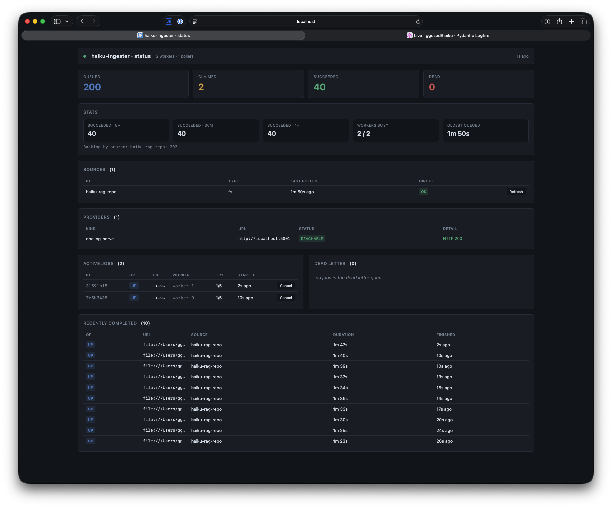

# Ingester

`haiku-ingester` is a long-running service that watches sources for changes and keeps a haiku.rag database in step with them. It runs as its own process, keeps a job queue (SQLite by default, or Postgres) with retries and a dead-letter queue, and serves an HTTP control plane with a dashboard.

For one-off ingestion, `haiku-rag add-src` is enough, see [CLI](cli.md#add).

One ingester writes every database its configuration names, with one queue and one control plane. haiku.rag allows one writing process per database (see [Operational constraints](configuration/storage.md#operational-constraints)), so no other process writes them. MCP servers and other read-only consumers can run beside it.

## Install

```bash
pip install 'haiku.rag-slim[ingester]'
# or, with the full package:
pip install 'haiku.rag[ingester]'
```

The extra pulls `fastapi`, `uvicorn`, `sqlalchemy`, `aiosqlite`, `asyncpg` and the `s3` extra. It does not pull docling. The default converter, `docling-local`, also needs the `docling` extra: `haiku.rag-slim[ingester,docling]`. The full package includes it. Without docling, `haiku-ingester` exits at startup and names the extra.

## Configure sources

Sources are listed under `ingester.databases` in `haiku.rag.yaml`, keyed by the database they are ingested into: a name in `lancedb.databases`, or `haiku.rag` when none is configured. The minimum is one source:

```yaml
ingester:
  databases:
    haiku.rag:
      sources:
        - type: fs
          id: local-docs
          root: /Users/you/docs
          delete_orphans: true
```

With `lancedb.databases` configured, each key names one of its entries. One process ingests every database it names:

```yaml
lancedb:
  databases:
    papers: /srv/haiku/papers.lancedb
    wiki: s3://my-bucket/wiki.lancedb
    papers-release: {location: /srv/haiku/papers.lancedb, tag: v1}

ingester:
  databases:
    papers:
      sources:
        - type: fs
          id: papers
          root: /srv/papers
    wiki:
      sources:
        - type: s3
          id: wiki-export
          uri: s3://my-bucket/wiki-export/
        - type: http
          id: wiki-pages
          urls: [https://example.com/handbook.html]
```

```bash
haiku-ingester serve                         # papers and wiki
haiku-ingester run-batch                     # one sweep over both, then exit
haiku-ingester run-batch --db-name wiki      # wiki's sources only
```

The ingester writes every database a key names, each through its own client, and leaves the other entries to readers, such as `papers-release` here. A key naming no configured database, or one configured at a tag, fails at load, and so does an entry without sources. A configuration carrying `ingester.sources` fails at load. `run-batch` refuses to start when `ingester.databases` names no database. `serve` starts, ingests nothing until a [reload](#reloading-databases) adds a database, and deletes every queued and claimed job of its queue namespace, as it does for any source it does not configure.

One process serves every database. A [reload](#reloading-databases) adds or removes one while the others keep ingesting. A database that fails to start is logged at ERROR and skipped, and the others start: for example when it needs a migration, when its recorded embedder differs from the configuration, when its store is unreachable, when a hook's lifespan raises, when a source names an unregistered metadata provider, or when reconciliation fails. The next reload retries it. `/health` lists each skipped database with its error and reports `degraded`. Startup fails when every configured database fails, and deletes no job then. Invalid configuration, an unreachable queue, two sources sharing an id and two databases at one location still fail startup. If a conversion stalls, the process exits (see [Run it under a supervisor](#run-it-under-a-supervisor)), and every database waits for the restart. If a database's writes fail while the ingester runs, only that database's sources pause, since each source has its own worker circuit breaker. If databases must not stop together, run one ingester per database, each with its own queue or namespace.

Source ids are unique across every database: startup fails when two sources share an id, given or derived from their target. Two keys whose databases sit at one location fail startup too, a path and its `file://` URI included, and two names a case-insensitive filesystem treats as one directory, since a database has one writer. Each open database holds its own embedder client.

Every source takes `id`, `poll_interval_s`, `delete_orphans`, `max_file_size`, `retry`, `circuit_breaker` and `metadata_provider`. With `delete_orphans`, a document whose file disappears from the source is deleted. Without it, the document stays. A source deletes only the documents it owns: a document another source ingested last, or one ingested without a source, is left in place. A sweep deletes nothing when an `fs` source has a directory it cannot list, the root included, or when a source lists nothing while it still has documents it listed before. The sweep fails instead. `ignore_patterns` and `include_patterns` follow [gitignore syntax](https://git-scm.com/docs/gitignore#_pattern_format). Supported file extensions are matched case-insensitively (`.pdf`, `.PDF` and `.PdF` are equivalent); include and ignore patterns are case-sensitive.

### Removing or moving a source

To retire a source, remove it from the configuration, and delete its documents by hand if they should go. Its queued and claimed jobs are deleted when `serve`, `run-batch` or a manifest replay next starts, never by `--dry-run`, or when a reload removes its database. Its finished jobs stay until `retention_days` prunes them. This relies on one ingester per queue namespace (see [Postgres](#postgres)).

A source moved under another key keeps its id and its queue record. At the next start, reconciliation finds its documents missing from the new database and ingests them again there. The old database keeps its copies until they are deleted by hand.

### Filesystem

```yaml
ingester:
  databases:
    haiku.rag:
      sources:
        - type: fs
          id: local-docs                          # optional, derived from root
          root: /Users/you/docs
          poll_interval_s: 300
          delete_orphans: true
          ignore_patterns: ["**/.git/**", "**/node_modules/**"]
          include_patterns: ["*.md", "*.pdf"]    # optional allow-list
```

`watchfiles` delivers changes as they happen, and a periodic sweep catches anything missed while the service was down.

With `converter: docling-local`, a LaTeX document is converted where it sits, and `\input`, `\include` and `\includegraphics` read the files they name from its directory and below, whatever their extension and whatever `ignore_patterns` says. The files they pull in become searchable text. Do not watch a directory where untrusted users can write `.tex` files next to files that must stay private.

### S3 and object storage

```yaml
ingester:
  databases:
    haiku.rag:
      sources:
        - type: s3
          id: corp-docs
          uri: s3://my-bucket/incoming/
          poll_interval_s: 300
          delete_orphans: true
          ignore_patterns: ["draft*"]
          include_patterns: ["*.pdf", "*.md"]
          storage_options:
            endpoint: http://seaweed:8333         # omit for the AWS default chain
            aws_access_key_id: ${AWS_KEY}
            aws_secret_access_key: ${AWS_SECRET}
            region: us-east-1
            allow_http: "true"
```

Each sweep lists the prefix and fetches only keys whose ETag differs from the document's stored `metadata["source_revision"]`. The stored revision comes from the GET response that supplies the object's bytes. When the fetched bytes match the stored MD5, as after a multipart re-upload, only the revision is updated and nothing is re-chunked.

`storage_options` takes the same keys as `lancedb.storage_options`, so credentials written for the database work here too.

### HTTP

```yaml
ingester:
  databases:
    haiku.rag:
      sources:
        - type: http
          id: arxiv
          urls:
            - https://arxiv.org/pdf/2301.12345.pdf
          headers:
            Authorization: Bearer ${SOME_TOKEN}
          poll_interval_s: 86400
```

Change detection uses `HEAD`. A URL removed from `urls`, or answering `410 Gone`, counts as gone. Other failures leave the decision to the fetch. A URL whose server sends neither `ETag` nor `Last-Modified` is not fetched again once ingested. The source fetches only the URLs in `urls`, so its `headers` reach no other URL.

### WebDAV

```yaml
ingester:
  databases:
    haiku.rag:
      sources:
        - type: webdav
          id: nextcloud
          base_url: https://nextcloud.example.com/remote.php/dav/files/alice/Documents/
          username: alice
          password: ${NEXTCLOUD_APP_PASSWORD}
          ignore_patterns: ["**/Trash/**"]
          poll_interval_s: 600
```

Each sweep issues one `PROPFIND` with `Depth: infinity` against `base_url`. A file's `getetag`, or `getlastmodified` when the server sends no ETag, decides whether it changed. A file missing from the listing counts as gone. Fetches are plain `GET`s.

Redirects are followed for both `PROPFIND` and `GET`, so servers that redirect for a trailing slash or `http` to `https` work unchanged. A redirect that moves the collection to another path or host fails discovery, so the source can be pointed at the new location. Credentials are never sent to a different host.

`headers` can replace HTTP Basic with a bearer token:

```yaml
        - type: webdav
          id: kdrive
          base_url: https://kdrive.infomaniak.com/app/drive/123/
          headers:
            Authorization: Bearer ${KDRIVE_TOKEN}
```

### File size limits

`max_file_size` (bytes) rejects oversized files before they are read into memory. They go straight to the dead-letter queue.

```yaml
        - type: fs
          root: /data/docs
          max_file_size: 104857600        # 100 MB
```

FS sources check the file size before reading. S3 sources check the GET response's size before reading its body. HTTP and WebDAV rely on the `Content-Length` header, and a response without one, such as a chunked response, is fetched in full.

### Metadata providers

A source can attach custom metadata to every document it ingests through a `metadata_provider`, a callable an external package registers under the `haiku.rag.metadata_providers` entry-point group:

```yaml
        - type: webdav
          id: handbook
          base_url: https://dav.example.com/remote.php/dav/files/svc
          metadata_provider: example-provider
```

The entry point is a zero-argument callable returning the provider, so a class is its own factory. The ingester calls the provider with `(source_id, uri, result)`, where `result` is the source's `FetchResult`, and merges the returned dict into the document's metadata:

```python
# example_pkg/__init__.py
from urllib.parse import urlparse

from haiku.rag.sources import FetchResult


class Provider:
    async def __call__(
        self, source_id: str, uri: str, result: FetchResult
    ) -> dict:
        path = urlparse(uri).path
        return {
            "collection": source_id,
            "folder": path.rsplit("/", 1)[0] or "/",
            "bytes": str(len(result.body)),
        }
```

```toml
# in the provider package's pyproject.toml
[project.entry-points."haiku.rag.metadata_providers"]
example-provider = "example_pkg:Provider"
```

The provider is built once at startup, so it can hold a client or a cache. It runs when a document is fetched for a new or changed revision. An unchanged document is skipped without a fetch and keeps its stored provider metadata. The keys `md5`, `source_revision`, `content_type`, `source_id` and `parent_uri` are removed from provider output. A `metadata_provider` with no installed entry point fails startup. A provider exception is handled like any ingestion error: network and timeout errors retry, others go to the dead-letter queue.

The provider is also called for each [PDF attachment](configuration/processing.md#pdf-embedded-attachments) the ingester stores, new or with changed bytes, at any nesting depth. It receives the source id of the document the attachment came from, the attachment's URI (`<parent uri>#attachment=<percent-encoded name>`; nested attachments chain fragments), and a `FetchResult` holding the attachment's bytes and guessed content type, with `result.extra_metadata["parent_uri"]` set and `disk_path` and `revision` unset. A provider that should treat attachments differently can test `"parent_uri" in result.extra_metadata`. It is not called for an attachment the converter does not support, or for one whose bytes are unchanged, which keeps its stored provider metadata. A provider exception for an attachment is handled like one for the document it came from. Attachments carry no `source_id` (see [Which source a document came from](#which-source-a-document-came-from)).

### Custom sources

To ingest from something the four built-in types (`fs`, `http`, `s3`, `webdav`) do not cover, such as a git host or a ticketing system, a package registers a source factory under the `haiku.rag.sources` entry-point group and the configuration names it with `type: plugin`:

```yaml
        - type: plugin
          id: api-docs
          plugin: git
          options:
            owner: acme
            repo: api
            branch: main
            token: ${SCM_TOKEN}
```

`plugin` is the entry-point name. `options` is passed to the factory as given, and the factory validates it. The base source fields are handled by the ingester and are not part of `options`.

The factory takes the source id, the options, and the extension and size limits, and returns a `Source`:

```python
def __call__(
    self,
    *,
    source_id: str,
    options: dict,
    supported_extensions: list[str] | None,
    max_file_size: int | None,
) -> Source: ...
```

```python
class Source(Protocol):
    source_id: str

    def supports(self, uri: str) -> bool: ...

    # Current revision for `uri`, or None when there is no cheap lookup.
    async def head(self, uri: str) -> str | None: ...

    # Release resources (connection pools, etc.). Called once at shutdown.
    async def aclose(self) -> None: ...

    async def fetch(self, uri: str) -> FetchResult: ...

    # Yield UPSERT / UNCHANGED / DELETE events. `since` is the uri -> revision
    # snapshot from the previous sweep, so the source can emit only changes.
    def discover(
        self,
        since: RevisionSnapshot | None = None,
        *,
        known_uris: set[str] | None = None,
    ) -> AsyncIterator[SourceEvent]: ...
```

`FetchResult`, `SourceEvent`, `SourceEventKind` and `RevisionSnapshot` are in `haiku.rag.sources`.

```toml
# in the source package's pyproject.toml
[project.entry-points."haiku.rag.sources"]
git = "example_pkg:build_git_source"
```

Only plugins a source references are imported. A `plugin` name with no installed entry point fails startup, as does a factory that returns something other than a `Source`.

Custom sources are reached through the ingester only, not through `haiku-rag add-src`. Change detection is per source and URI, so a source that needs one cursor for the whole source (a git commit SHA, say) keeps it in each URI's revision or under a sentinel URI.

## Workers and retry

```yaml
ingester:
  workers:
    worker_count: 4
    poll_idle_interval_s: 1.0
    lease_ttl_s: 120
    heartbeat_interval_s: 30
    reaper_interval_s: 60
    shutdown_grace_s: 60            # SIGTERM drains in-flight jobs up to this long
    retry:
      max_attempts: 5
      base_delay_s: 2.0
      max_delay_s: 300.0
      jitter: 0.25                  # ±25%
```

`worker_count` workers each process one job at a time, so it is also the most jobs in flight. Each claim takes the oldest ready job of the source with the fewest jobs in flight, and among those the source claimed least recently, so a backlog in one source does not hold every worker. The share is per source, not per database: a database with ten sources gets ten shares against a database with one. Processes sharing a queue each balance only their own claims. A job failing with a transient error is retried with exponential backoff and jitter up to `max_attempts`, then moves to the dead-letter queue. A permanent error skips retries: an unsupported extension, an HTTP 4xx other than 408 and 429, an object-store credential or configuration error.

A DELETE job skipped because the resource is back at the source completes successfully and preserves its sync state and earlier dead or rejected jobs. Discovery can still detect a later removal. If the document belongs to another source or has no owner, the worker leaves it indexed and removes only the requesting source's sync state and failed jobs for that URI.

A worker renews its job's lease every `heartbeat_interval_s`. The reaper returns a job to the queue when its lease has not been renewed for `lease_ttl_s`, so a crashed worker's job is picked up again. A slow job keeps renewing and is never reaped while it runs.

- `lease_ttl_s` bounds how long a crashed worker's job waits before another worker takes it. It need not exceed job duration.
- `heartbeat_interval_s` must be at most `lease_ttl_s / 3`.
- `worker_count` should match downstream capacity. With docling-serve, start at 1–2× the number of `providers.docling_serve.base_url` entries, see [Remote processing](remote-processing.md#several-instances).
- `poll_idle_interval_s`: lower picks up work faster and queries the queue more often.
- `reaper_interval_s`: a crashed worker's job is reclaimed within `lease_ttl_s + reaper_interval_s`.

A poller skips its periodic sweep while its source has queued or claimed jobs. Filesystem change events still flow during a skipped sweep.

On `SIGINT` or `SIGTERM`, pollers stop and workers get `shutdown_grace_s` to finish. Jobs still running after that are cancelled and returned to the queue. A job that cannot be returned is reclaimed by the reaper once its lease expires.

A source can override the retry policy:

```yaml
ingester:
  databases:
    haiku.rag:
      sources:
        - type: http
          id: flaky-api
          urls: [...]
          retry:
            max_attempts: 10
            base_delay_s: 10
```

The block replaces the worker's policy for that source's jobs. A field it leaves out takes the policy default, not the worker's value.

## Circuit breaker

After `failure_threshold` consecutive discovery failures, a source's circuit breaker opens and its polling pauses for `cooldown_s`. Other sources keep running.

```yaml
ingester:
  databases:
    haiku.rag:
      sources:
        - type: http
          id: rate-limited
          urls: [...]
          circuit_breaker:
            failure_threshold: 5
            cooldown_s: 600
```

Workers keep a second breaker per source over job failures. After 5 consecutive transient job failures they stop claiming that source's jobs for 60 seconds. Both values are fixed. `/health` reports the breaker, and opening it emits an `ingester.worker breaker opened` event.

## Run it

```bash
haiku-ingester serve                          # workers, pollers and API
haiku-ingester serve --no-api                 # workers and pollers only
haiku-ingester serve --host 0.0.0.0           # bind the API on all interfaces
haiku-ingester serve --port 9000              # API port
```

`--host` and `--port` override `ingester.api.host` and `ingester.api.port`, which default to `127.0.0.1:8765`. `--config`/`-c` names the configuration file.

The service runs until `SIGINT` or `SIGTERM`, then cancels any reload, and stops the API server, the pollers and the workers, in that order. `SIGHUP` [reloads the databases](#reloading-databases).

### Reloading databases

`POST /reload` and `SIGHUP` read the configuration file again and apply what changed in `lancedb.databases` and `ingester.databases`:

- A database in the file and not running is added: opened, created if missing, reconciled, then swept.
- A running database missing from the file is removed.
- A database whose location or sources changed is removed, then added.

To remove a database, a reload stops claiming its jobs, stops its pollers once any sweep in progress ends, waits for its jobs in flight, deletes its queued and claimed jobs and its `sync_state` rows, and closes it. Its documents stay. The wait has no limit, so a removal lasts as long as the longest job in flight. The other databases keep ingesting throughout. A database added back is swept as new: every document is queued again, and one already stored at the same revision is not converted again.

The file is the one named by `--config`, or found by the default lookup, at startup. Each reload follows a symlink at that path to its current target, as on a Kubernetes ConfigMap mount. `--host`, `--port` and `--root-path` override the file again on each reload. A reload refuses a change to any other section with 409 and names the sections, which need a restart. A file that fails to load or fails a startup check, such as two sources sharing an id, answers 422. Without a configuration file, a reload answers 409. Nothing changes in any of these cases.

Reloads run one at a time, and the response comes once the change is applied. It answers 200 when everything applied, and 500 with the same body when a database failed:

```json
{
  "outcome": "partial",
  "databases": [
    {"database": "legacy", "change": "removed", "error": null},
    {"database": "renamed", "change": "failed", "error": "database 'renamed': ..."}
  ]
}
```

`outcome` is `applied`, `failed` when a database failed and the reload added or removed none, or `partial`. Additions are opened before any removal starts, except an addition at the location of a removed database, such as a rename. An addition that fails to open, start its hooks, build its metadata providers or reconcile is logged at ERROR and skipped, and the others are added. A database whose location or sources changed is removed even when its new placement fails to open. The next reload retries a skipped database. A failed removal stops the reload: the changes already applied stay, and the next reload applies the rest. A database whose removal failed is removed first by the next reload. `/config` shows the configuration of the last reload that got past its removals, and `/sources` shows what runs.

A client that disconnects does not stop a reload. Shutdown does: a reload in progress and those waiting answer 503, and the next start reads the file. Under `SIGHUP` the outcome is logged, and signals arriving during a reload queue one more. Write the file atomically, through a temporary file in the same directory and a rename, so that a reload never reads half of it.

### Run it under a supervisor

A document can stall docling indefinitely. `processing.conversion_timeout` abandons it, but a stalled PDF or office conversion holds docling's shared converter, so the process cannot convert again. The worker records the document dead and exits non-zero, for the process to be replaced.

So the service needs something to restart it: `restart: unless-stopped` in Compose (the example sets it), `Restart=always` in a systemd unit. Without one, the ingester stops the first time a document stalls. A restart mid-job is safe: the reaper returns the jobs of a vanished process to the queue once their leases expire, without counting the attempt.

The stalled document is not retried by itself. Its dead job keeps discovery from queueing the same revision again, and retention never removes it. It is cleared by:

- a new revision of the file at the source
- `POST /dlq/{job_id}/retry`, once the document is fixed. Retrying a different dead job for the same document and revision answers 409 and names the job in the way
- deleting the document

An HTML or Markdown stall is recorded the same way but does not end the process, since those formats do not share a converter.

## HTTP control plane

The ingester serves a FastAPI control plane on `127.0.0.1:8765`. `ingester.api.auth_token` requires a bearer token on every route except `/` and `/health`. Without a token the API is open and the service logs a warning.

!!! warning "Non-loopback binds need a token"
    Loopback is local-only. On any other interface (`0.0.0.0`, a LAN address, behind a reverse proxy) set `auth_token`: the control plane can cancel jobs, retry dead ones and trigger sweeps. The startup warning is the only sign that it is missing.

| Method | Path | Purpose |
|---|---|---|
| `GET` | `/` | Browser dashboard. Unauthenticated. Its script sends the token on its own requests |
| `GET` | `/health` | Queue counts, live workers and pollers, worker breaker state, and `failed_databases`: each configured database that is not running, as `{"database", "error"}`. `status` is `degraded` when a worker or poller is down, the worker breaker is open or a configured database is not running. Unauthenticated |
| `GET` | `/sources` | Configured sources, the database each feeds, last poll time, breaker state, last skip reason, and the error and time of the last failed discovery, cleared by the next successful sweep. `last_polled_at` is when the last successful sweep started: every file that matches the source's filters and changed before it has been listed, unless it was removed during the sweep |
| `POST` | `/sources/{id}/refresh` | Run a sweep now, after any sweep of the source in progress. Skipped (`refreshed: false`) while the source has queued or claimed jobs, its breaker is open or a reload is removing it |
| `POST` | `/sources/{id}/retry` | Re-queue the source's failed jobs selected by the required `status` (`dead`, `rejected` or `all`), as `run-batch --retry` does, after any sweep of the source in progress and with no discovery of it running meanwhile. Returns `retried`, the count, and `worker_breaker_open`: while the source's worker breaker is open, the jobs stay queued. 409 for a source that is not served or that a reload is removing |
| `GET` | `/jobs` | Jobs filtered by `status`, `source_id`, `uri`, `limit`, `offset` |
| `GET` | `/jobs/{id}` | One job |
| `POST` | `/jobs/{id}/retry` | Reset a dead, rejected or queued job to queued with zero attempts. Returns the live job instead when one exists for the same URI, and 409 for a job whose source is not configured |
| `DELETE` | `/jobs/{id}` | Cancel a queued or claimed job |
| `GET` | `/dlq` | Dead jobs, filtered by `source_id`, `limit` (default 50, at most 500), `offset` |
| `POST` | `/dlq/{id}/retry` | Re-queue a dead job, as `/jobs/{id}/retry` does |
| `GET` | `/stats` | Throughput over 5 minutes, 30 minutes and 1 hour, worker occupancy, oldest queued age, per-source dead, rejected and backlog counts. The dead and rejected counts count jobs kept for history, not distinct URIs |
| `GET` | `/databases/{name}` | The report `haiku-rag info` prints, for one ingested database. 404 for any other name |
| `GET` | `/config` | The effective configuration, defaults filled in and secrets redacted, as YAML text in a JSON `yaml` field |
| `POST` | `/reload` | Read the configuration file again and apply its changes to the databases. 500 when a database failed (see [Reloading databases](#reloading-databases)) |
| `GET` | `/providers` | Reachability of each `providers.docling_serve.base_url` entry (`/health`, 2 s timeout) |

OpenAPI docs are at `/docs`. The dashboard at `/` shows the same data and refreshes every few seconds. A source whose last discovery failed is marked `sweep failed`, with the error on hover. Retry failed on a source re-queues its dead jobs, as `/sources/{id}/retry?status=dead` does. A configured database that is not running is marked `NOT RUNNING` beside the health detail, with its error on hover. With more than one database, the sources table names each source's database, and the database panel selects the database it reports on.



```yaml
ingester:
  api:
    enabled: true
    host: 127.0.0.1
    port: 8765
    auth_token: ${INGESTER_TOKEN}             # unset: unauthenticated
    root_path: ""                             # e.g. /ingester behind a proxy
```

### Behind a reverse proxy

`ingester.api.root_path` (or `serve --root-path /ingester`) serves the control plane under a sub-path, such as `https://host/ingester/`. The OpenAPI docs and the dashboard's requests follow the prefix. The value is normalized to one leading slash and no trailing slash. Strip the prefix at the proxy, for example with nginx:

```nginx
# Redirect the bare prefix to the trailing-slash form, where the dashboard's
# <base href> resolves.
location = /ingester {
    return 308 /ingester/;
}

location /ingester/ {
    rewrite ^/ingester/?(.*)$ /$1 break;
    proxy_pass http://127.0.0.1:8765;
}
```

## Operating

### One-shot batch build

`run-batch` runs one discovery sweep over every source, drains the queue and exits. New and changed files are ingested, and, with `delete_orphans`, documents whose files are gone are deleted. It is the mode for building a database in CI or on a schedule.

```bash
haiku-ingester run-batch                     # every database in ingester.databases
haiku-ingester run-batch --db-name papers    # one of them
```

`--db-name` sweeps that database's sources and drains their jobs only. `--retry` and `--dry-run` follow the selection, and the other databases' queued jobs stay queued. `--manifest` takes a manifest from a dry run with the same `--db-name`, and refuses one naming another database's sources. It is still a writer of that database, so it must not run while `serve` writes it.

It ingests the databases that started and exits non-zero naming each skipped one, as it does when a job dead-letters or a source's sweep does not complete. A job whose document a hook rejected is `rejected`, not dead, and does not change the exit code. The summary counts it apart: `Batch complete: 12 succeeded, 0 dead, 2 rejected`. Deletion compares each source against the queue's record of what it ingested, so keep `ingester.db` between runs.

`--retry dead`, `--retry rejected` or `--retry all` re-queues failed jobs after the sweep, and the batch drains them with the rest. A dead or rejected job records its source revision, so a sweep does not queue the unchanged file again:

```bash
haiku-ingester run-batch --retry dead
```

Only the latest failure of each document is re-queued, and only when nothing ingested the document after it. A dead job stays in the queue after a later success until retention removes it. A stalled conversion is re-queued too, and can stall the run again, or end the process when it wedges the converter. `Retried N job(s)` precedes the summary line, and a retried job that fails again counts as dead. `--retry` cannot be combined with `--dry-run` or `--manifest`.

`--dry-run` makes the same discovery without queueing anything, and writes the changes it found to a YAML manifest, `manifest-<datestamp>.yaml` unless `--output`/`-o` names one:

```bash
haiku-ingester run-batch --dry-run
haiku-ingester run-batch --dry-run --output manifest-20260622.yaml
```

`--manifest` replays exactly that changeset, without another sweep:

```bash
haiku-ingester run-batch --manifest manifest-20260622.yaml
```

Replay refuses a source with queued or claimed jobs, and a change of a database that failed to start. An upsert with a revision is checked against the source before fetching, and one that changed since the dry run dead-letters, leaving the newer version to the next dry run. A source that reports no revisions cannot prove at replay that the bytes are the ones the dry run saw.

### Which source a document came from

A document the ingester fetches carries `metadata["source_id"]`, the id of the source that ingested it. Documents added with `haiku-rag add-src` have none. Neither do PDF attachments, which belong to their parent document and are deleted with it.

Only ingestion sets `source_id`, and `HaikuRAG.set_document_source`, which startup reconciliation uses. Passing it as metadata does nothing, and re-adding an ingested document by hand keeps it.

A source id is an identity. An `fs` source without an `id` derives it from its root (`fs:{resolved_root}`), and an `s3` source from its bucket and prefix (`s3:{bucket}/{prefix}`). Moving the directory or prefix, or renaming an `id`, detaches every document ingested under the old one. Set `id` on a source whose location may move:

```yaml
ingester:
  databases:
    haiku.rag:
      sources:
        - type: fs
          id: handbook
          root: /srv/handbook
```

When two sources of one database cover the same URI (nested roots or prefixes, one URL in two `http` sources), the latest ingestion takes ownership and a warning names both ids. Overlapping sources within a database are a configuration error. Sources of different databases may cover the same URI: each database holds its own copy.

### Reconciliation at startup

The ingester's state is in two places: the documents in the database, and the queue's record of what each source ingested, which deletion is computed from. Either can be restored or lost without the other, for example a queue file on container-local storage or a database restored from backup.

Every `serve` and `run-batch` reconciles them before its first sweep. For each source, against the database it is ingested into:

- A document the source owns with no queue record gets one back, so the next sweep can delete it if its file is gone.
- A recorded revision for a URI the database no longer holds is cleared, so the next sweep re-ingests it.
- A document without `source_id` that the source's queue records as ingested is attributed to the source, without a fetch.

A permanently failed job also records a revision, which keeps an unchanged failing file from being queued forever. Reconciliation leaves those alone.

A document two sources both ingested stays unattributed, with a warning naming them. Documents of a `source_id` no longer configured are counted in a warning and left alone. Reconciliation reads the document metadata table once and no content.

`run-batch --dry-run` opens no database, so a manifest written while the two disagreed misses the deletions reconciliation would find, and `--manifest` replay does not sweep. A normal sweep afterwards catches up.

### Documents with no source attribution

At startup, reconciliation reports documents that remain unattributed:

```
14 document(s) remain without source attribution. Review whether they are
intentionally unmanaged or have ambiguous or lost ownership.
```

PDF attachments of a stored document are not counted. An unattributed document was added by hand, was ingested by a version that did not record `source_id` and whose queue record is gone, is claimed by two sources and named in its own warning, or is a PDF attachment whose parent document is gone. Claimed documents need the sources separated, not the document deleted. While a lost document's file is still at its source, the next sweep attributes it. Once the file is gone, nothing identifies it.

To clear them:

**1. Run one batch and check it succeeds.**

```bash
haiku-ingester --config /etc/haiku/haiku.rag.yaml run-batch
echo $?    # must be 0
```

Reconciliation attributes what the queue records, and the sweep attributes what it finds. An unchanged document costs no fetch, conversion or embedding. A non-zero exit means a source failed to sweep or a job died, so some live documents may still be unattributed. Fix that and run again before step 2.

**2. List what is left.**

```bash
haiku-rag --config /etc/haiku/haiku.rag.yaml list \
  -f "metadata NOT LIKE '%\"source_id\"%' AND metadata NOT LIKE '%\"parent_uri\"%'"
```

Narrow it on a database that also holds hand-added documents:

```bash
  -f "metadata NOT LIKE '%\"source_id\"%' AND metadata NOT LIKE '%\"parent_uri\"%' AND uri LIKE 'file:///srv/handbook/%'"
```

The list holds candidates to review, not documents to delete. `metadata` is matched as JSON text, so a document whose own metadata contains the string `source_id` or `parent_uri` is left out.

PDF attachments are listed with `-f "metadata LIKE '%\"parent_uri\"%'"`. An attachment is orphaned only when no document in the database has the URI its `parent_uri` names. Check that with a filter on `uri`, not with the attachment filter, which leaves top-level parents out.

**3. Delete what you confirm.**

```bash
haiku-rag --config /etc/haiku/haiku.rag.yaml delete <id>
```

Read the URIs first. A hand-added document whose file has since moved looks the same as one the ingester lost track of.

### The queue

The SQLite queue is `ingester.db` in the platform data directory (`~/Library/Application Support/haiku.rag/` on macOS), or `ingester.queue.path`. `serve` creates it. To create or migrate it ahead of time:

```bash
haiku-ingester queue init             # create the database and schema
haiku-ingester queue migrate          # apply pending schema changes
haiku-ingester queue init -q /var/lib/haiku-rag/ingester.db   # at another path
```

Succeeded, dead and rejected jobs are kept for history. The reaper deletes those completed more than `retention_days` ago:

```yaml
ingester:
  queue:
    path: /var/lib/haiku-rag/ingester.db
    retention_days: 30                # null keeps them all
```

#### Postgres

`ingester.queue.dburi` points the queue at Postgres, with a SQLAlchemy async URL, and `namespace` names the ingester that owns its rows:

```yaml
ingester:
  queue:
    dburi: postgresql+asyncpg://ingester_rw:${QUEUE_DB_PASSWORD}@db:5432/haiku_queue
    namespace: papers
```

The `asyncpg` driver comes with the `ingester` extra. `dburi` overrides `path` and the `--queue` flag.

Several ingesters share one Postgres queue, each under its own namespace and each writing its own databases. An ingester claims, counts, prunes and serves through its API the rows of its namespace and no others, so source ids need to be unique within a namespace, not across the queue. A namespace is stable across restarts and upgrades: an ingester started under a new one does not see the rows recorded under the old. Two constraints hold independently. A namespace has one process: a second one deletes the first's queued and claimed jobs at startup, as jobs of sources it does not configure. A database has one writer (see [storage](configuration/storage.md)): two namespaces never ingest into the same database. The database role sees every row: namespaces separate ingesters in the application, not in Postgres.

`serve`, `run-batch` and `--dry-run` refuse a server `dburi` without a namespace, and never create or migrate a server queue: they read its schema version and fail naming the command to run. A SQLite queue is owned by one process, migrates itself at startup and records its rows under `namespace`, empty unless configured.

##### Deployment

An account that owns the queue's tables creates and migrates them, through `haiku-ingester queue init` and `queue migrate`. The ingesters run as an account that can only read and write rows. `--dburi`, or `HAIKU_RAG_QUEUE_DBURI`, gives the two commands the owner's URL, so it never appears in the configuration the ingesters read:

```bash
haiku-ingester queue init --dburi postgresql+asyncpg://queue_owner:${OWNER_PASSWORD}@db:5432/haiku_queue
```

The owner grants the ingesters' account its rights once the tables exist, and again after a migration that adds a table:

```sql
GRANT USAGE ON SCHEMA public TO ingester_rw;
GRANT SELECT, INSERT, UPDATE, DELETE ON jobs, sync_state TO ingester_rw;
GRANT SELECT ON schema_version TO ingester_rw;
```

To keep the queue in a schema of its own, create the schema and point both accounts at it before `queue init`, with the `GRANT USAGE` above on that schema:

```sql
CREATE SCHEMA haiku_queue;
ALTER ROLE queue_owner SET search_path = haiku_queue;
ALTER ROLE ingester_rw SET search_path = haiku_queue;
```

A release that changes the queue schema rolls out in one order: stop every ingester, run `haiku-ingester queue migrate --dburi ...` as the owner, start the upgraded ingesters. Releases never share a queue: a new one refuses a queue that is behind, and an old one writes a migrated queue with its old statements. The first such release is schema 4, below.

Each ingester process holds at most five connections to the queue: two kept open and three more under load, closed when returned. Size `max_connections` for five per process, plus the owner's migration and any dashboard. A sweep's `sync_state` writes go in one transaction, which holds its connection for the sweep's batch. PgBouncer in transaction mode is untested.

##### Upgrading a queue from schema 3

Queue schema 4 adds the namespace. The migration leaves every existing row under the empty namespace, and the ingester reads only its own, so hand the rows over before it starts:

1. Stop the ingester. One still running claims and prunes rows of every namespace.
2. `haiku-ingester queue migrate --dburi ...` as the owner.
3. Assign the namespace to the migrated rows, in one transaction:

    ```sql
    UPDATE jobs SET namespace = 'papers' WHERE namespace = '';
    UPDATE sync_state SET namespace = 'papers' WHERE namespace = '';
    ```

4. Start the ingester with `namespace: papers`.

A queue that several ingesters already wrote to needs a mapping from `source_id` to namespace in step 3. SQLite queues need nothing.

##### Upgrading a queue from schema 4

Queue schema 5 adds the `rejected` job status. The migration changes no table, but ingesters sharing a server queue still upgrade together, in the order above. SQLite queues migrate themselves.

##### Upgrading a queue from schema 5

Queue schema 6 adds an index over each source's queued jobs. Server queues migrate with `haiku-ingester queue migrate`, in the order above. SQLite queues migrate themselves.

### Logs and tracing

The service logs to stderr:

```
INFO     Ingester running: 4 worker(s), 1 source(s)
INFO     API listening on 127.0.0.1:8765
INFO     Swept local-docs: 142 upsert, 0 delete, 8 unchanged
INFO     Processing upsert file:///.../a.md (job 5d9a...)
INFO     Job 5d9a... succeeded in 0.34s: file:///.../a.md
```

With `LOGFIRE_TOKEN` set, spans are sent to Logfire with `service.name` `haiku-ingester` and `service.version`. `OTEL_SERVICE_NAME` (or `LOGFIRE_SERVICE_NAME`) names a process differently, to tell concurrent ingesters apart:

```bash
OTEL_SERVICE_NAME=ingester-tenant-a haiku-ingester serve
```

A one-shot command (`run-batch`, or the `queue` commands) started with `TRACEPARENT` / `TRACESTATE` in its environment joins that trace. `serve` never joins. The parent's sampling decision applies, so a `TRACEPARENT` with the sampled flag `00` suppresses the command's spans.

The span tree is `ingester.poller.sweep` → `ingester.job` (with `source_id` and `uri`) → one span per phase: `document.fetch`, `document.convert`, `document.chunk`, `document.embed`, `document.items` and `document.store`. The phase spans are siblings: each times one phase, so a slow `document.store` is a slow write. `document.embed` reports `chunks`, `chunks_embedded`, `images` and `batch_size`, and is emitted when no chunk needs embedding. `document.store` reports `op` (`create` / `update` / `create_batch`), `document_id`, `chunks`, `items` and `lock_wait_ms`, the time spent waiting on the write lock. That lock is in-process, so contention between two ingester processes on one database is not measured. `_prepare_and_title` and `get_all_picture_data` run outside any phase span, so the phases do not sum to the job. Each docling-serve request adds a `docling_serve.request` span with the instance `url` and `attempt`. A worker breaker opening emits an `ingester.worker breaker opened` event with `source_id`, `threshold` and `cooldown_s`.

### Operating against the API

```bash
TOKEN=$INGESTER_TOKEN   # omit -H when no token is configured

curl http://localhost:8765/health
curl -H "Authorization: Bearer $TOKEN" http://localhost:8765/sources
curl -H "Authorization: Bearer $TOKEN" 'http://localhost:8765/jobs?status=dead'

# Sweep a source now
curl -H "Authorization: Bearer $TOKEN" -X POST \
    http://localhost:8765/sources/local-docs/refresh

# Retry a dead job
curl -H "Authorization: Bearer $TOKEN" -X POST \
    http://localhost:8765/jobs/<id>/retry

# Apply the configuration file's database changes
curl -H "Authorization: Bearer $TOKEN" -X POST http://localhost:8765/reload
```

### Reading the queue from Python

A deployment that only runs `run-batch` has no HTTP API. The queue's read side is in `haiku.rag.ingester.queue`:

```python
from haiku.rag.ingester.queue import JobRepo, JobStatus, SyncStateRepo, open_queue

engine = await open_queue(config.ingester.queue)
try:
    jobs = JobRepo(engine, namespace=config.ingester.queue.namespace)
    rejected = await jobs.list_jobs(status=JobStatus.REJECTED, limit=100)
finally:
    await engine.dispose()
```

- `open_queue(queue_config)` returns the engine. It migrates a SQLite file and refuses one newer than the release. A server queue is only checked: one behind or ahead of the release is refused, naming the command to run. `haiku.rag.ingester.queue.migrations.verify_schema(engine)` makes the same check and writes nothing, for an account that can only read.
- `JobRepo(engine, namespace)` reads with `get_job(job_id)`, `list_jobs(status=, source_id=, uri=, limit=, offset=)` (newest enqueued first), `counts_by_status()`, and `counts_by_status_since(since)`, which counts the jobs completed at or after `since`, as the `run-batch` summary does.
- `SyncStateRepo(engine, namespace)` reads with `get_row(source_id, uri)`, `list_known_uris(source_id)` and `list_ingested_uris(source_id)`.

Pass the namespace the ingester runs under, `ingester.queue.namespace`, which is `""` unless configured. The methods that change rows belong to the ingester.
