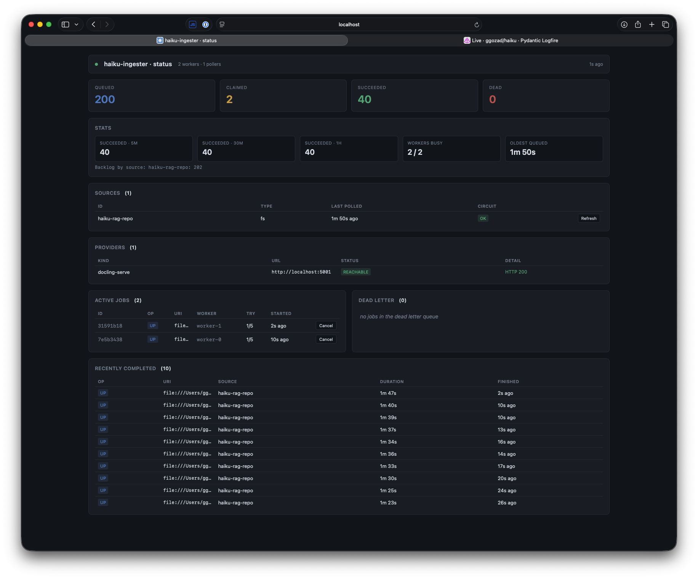

# Running the ingester

## Run it

```bash
haiku-ingester serve                          # workers, pollers and API
haiku-ingester serve --no-api                 # workers and pollers only
haiku-ingester serve --host 0.0.0.0           # bind the API on all interfaces
haiku-ingester serve --port 9000              # API port
haiku-ingester serve --fd 3                   # API on an inherited listening socket
```

`--host` and `--port` override `ingester.api.host` and `ingester.api.port`, which default to `127.0.0.1:8765`. `--fd` overrides `ingester.api.fd`: the API serves on that already-listening socket, such as fd 3 from systemd socket activation, instead of binding a host and port. launchd passes no fixed descriptor: a launchd job needs a launcher that calls `launch_activate_socket()` and passes the descriptor to `--fd`. `--config`/`-c` names the configuration file.

The service runs until `SIGINT` or `SIGTERM`, then cancels any reload, and stops the API server, the pollers and the workers, in that order. `SIGHUP` [reloads the databases](#reloading-databases).

### Reloading databases

`POST /reload` and `SIGHUP` read the configuration file and its [database fragments](../configuration/index.md#database-fragments) again and apply what changed in `lancedb.databases` and `ingester.databases`:

- A database in the file and not running is added: opened, created if missing, reconciled, then swept.
- A running database missing from the file is removed.
- A database whose location or sources changed is removed, then added.

To remove a database, a reload stops claiming its jobs, stops its pollers once any sweep in progress ends, waits for its jobs in flight, deletes its queued and claimed jobs and its `sync_state` rows, and closes it. Its documents stay. The wait has no limit, so a removal lasts as long as the longest job in flight. The other databases keep ingesting throughout. A database added back is swept as new: every document is queued again, and one already stored at the same revision is not converted again.

The file is the one named by `--config`, or found by the default lookup, at startup. Each reload follows a symlink at that path to its current target, as on a Kubernetes ConfigMap mount. `--host`, `--port`, `--fd` and `--root-path` override the file again on each reload. A reload refuses a change to any other section with 409 and names the sections, which need a restart. A file that fails to load or fails a startup check, such as two sources sharing an id, answers 422. Without a configuration file, a reload answers 409. Nothing changes in any of these cases.

Reloads run one at a time, and the response comes once the change is applied. It answers 200 when everything applied, and 500 with the same body when a database failed:

```json
{
  "outcome": "partial",
  "databases": [
    {"database": "legacy", "change": "removed", "error": null},
    {"database": "renamed", "change": "failed", "error": "database 'renamed': ..."}
  ]
}
```

`outcome` is `applied`, `failed` when a database failed and the reload added or removed none, or `partial`. Additions are opened before any removal starts, except an addition at the location of a removed database, such as a rename. An addition that fails to open, start its hooks, build its metadata providers or reconcile is logged at ERROR and skipped, and the others are added. A database whose location or sources changed is removed even when its new placement fails to open. The next reload retries a skipped database. A failed removal stops the reload: the changes already applied stay, and the next reload applies the rest. A database whose removal failed is removed first by the next reload. `/config` shows the configuration of the last reload that got past its removals, and `/sources` shows what runs.

A client that disconnects does not stop a reload. Shutdown does: a reload in progress and those waiting answer 503, and the next start reads the file. Under `SIGHUP` the outcome is logged, and signals arriving during a reload queue one more. Write the file atomically, through a temporary file in the same directory and a rename, so that a reload never reads half of it.

### Run it under a supervisor

A document can stall docling indefinitely. `processing.conversion_timeout` abandons it, but a stalled PDF or office conversion holds docling's shared converter, so the process cannot convert again. The worker records the document dead and exits non-zero, for the process to be replaced.

So the service needs something to restart it: `restart: unless-stopped` in Compose (the example sets it), `Restart=always` in a systemd unit. Without one, the ingester stops the first time a document stalls. A restart mid-job is safe: the reaper returns the jobs of a vanished process to the queue once their leases expire. A job reaped on its last attempt goes dead and, except for a DELETE, is held as a stalled document is.

The stalled document is not retried by itself. Its dead job keeps discovery from queueing the same revision again, and retention never removes it. It is cleared by:

- a new revision of the file at the source
- `POST /dlq/{job_id}/retry`, once the document is fixed. Retrying a different dead job for the same document and revision answers 409 and names the job in the way
- deleting the document

An HTML or Markdown stall is recorded the same way but does not end the process, since those formats do not share a converter.

## One-shot batch build

`run-batch` runs one discovery sweep over every source, drains the queue and exits. New and changed files are ingested, and, with `delete_orphans`, documents whose files are gone are deleted. It is the mode for building a database in CI or on a schedule.

```bash
haiku-ingester run-batch                     # every database in ingester.databases
haiku-ingester run-batch --db-name papers    # one of them
```

`--db-name` sweeps that database's sources and drains their jobs only. `--retry` and `--dry-run` follow the selection, and the other databases' queued jobs stay queued. `--manifest` takes a manifest from a dry run with the same `--db-name`, and refuses one naming another database's sources. It is still a writer of that database, so it must not run while `serve` writes it.

It ingests the databases that started and exits non-zero naming each skipped one, as it does when a job dead-letters, a source's sweep does not complete or a database's [maintenance](#maintenance) pass fails. A job whose document a hook rejected is `rejected`, not dead, and does not change the exit code. The summary counts it apart: `Batch complete: 12 succeeded, 0 dead, 2 rejected`. Deletion compares each source against the queue's record of what it ingested, so keep `ingester.db` between runs.

`--retry dead`, `--retry rejected` or `--retry all` re-queues failed jobs after the sweep, and the batch drains them with the rest. A dead or rejected job records its source revision, so a sweep does not queue the unchanged file again:

```bash
haiku-ingester run-batch --retry dead
```

Only the latest failure of each document is re-queued, and only when nothing ingested the document after it. A dead job stays in the queue after a later success until retention removes it. A stalled conversion is re-queued too, and can stall the run again, or end the process when it wedges the converter. `Retried N job(s)` precedes the summary line, and a retried job that fails again counts as dead. `--retry` cannot be combined with `--dry-run` or `--manifest`.

`--dry-run` makes the same discovery without queueing anything, and writes the changes it found to a YAML manifest, `manifest-<datestamp>.yaml` unless `--output`/`-o` names one:

```bash
haiku-ingester run-batch --dry-run
haiku-ingester run-batch --dry-run --output manifest-20260622.yaml
```

`--manifest` replays exactly that changeset, without another sweep:

```bash
haiku-ingester run-batch --manifest manifest-20260622.yaml
```

Replay refuses a source with queued or claimed jobs, and a change of a database that failed to start. An upsert with a revision is checked against the source before fetching, and one that changed since the dry run dead-letters, leaving the newer version to the next dry run. A source that reports no revisions cannot prove at replay that its bytes match what the dry run saw.

## Workers and retry

```yaml
ingester:
  workers:
    worker_count: 4
    poll_idle_interval_s: 1.0
    lease_ttl_s: 120
    heartbeat_interval_s: 30
    reaper_interval_s: 60
    shutdown_grace_s: 60            # SIGTERM drains in-flight jobs up to this long
    retry:
      max_attempts: 5
      base_delay_s: 2.0
      max_delay_s: 300.0
      jitter: 0.25                  # ±25%
```

`worker_count` workers each process one job at a time, so it is also the most jobs in flight. Each claim takes the oldest ready job of the source with the fewest jobs in flight, and among those the source claimed least recently, so a backlog in one source does not hold every worker. The share is per source, not per database: a database with ten sources gets ten shares against a database with one. Processes sharing a queue each balance only their own claims. A job failing with a transient error is retried with exponential backoff and jitter up to `max_attempts`, then moves to the dead-letter queue. A dead job records its source revision, so a sweep does not queue the file again while that revision is unchanged. Retrying the dead-letter entry, for example with `POST /sources/{id}/retry?status=dead`, queues it again. A permanent error skips retries: an unsupported extension, an unparseable file or one with an undetectable text encoding, an HTTP 4xx other than 408 and 429, an object-store credential or configuration error.

A DELETE job skipped because the resource is back at the source completes successfully and preserves its sync state and earlier dead or rejected jobs. Discovery can still detect a later removal. If the document belongs to another source or has no owner, the worker leaves it indexed and removes only the requesting source's sync state and failed jobs for that URI. A DELETE for a URL confirmed gone by a 404 keeps the source's sync state, at revision `http-404`.

A worker renews its job's lease every `heartbeat_interval_s`. The reaper returns a job to the queue when its lease has not been renewed for `lease_ttl_s`, so a crashed worker's job is picked up again. The job keeps its attempt. A job on its last attempt goes to the dead-letter queue instead and, except for a DELETE, is held like a stalled document (see [Run it under a supervisor](#run-it-under-a-supervisor)), so a document that crashes the process stops being retried. Every job in flight when a process dies counts the attempt, not only the one that caused it. The reaper never returns a job that its own process is running, so a slow job, a clock that jumps forward or a process that was suspended does not lose a claim.

- `lease_ttl_s` bounds how long a crashed worker's job waits before another worker takes it. It need not exceed job duration.
- `heartbeat_interval_s` must be at most `lease_ttl_s / 3`.
- `worker_count` should match downstream capacity. With docling-serve, start at 1–2× the number of `providers.docling_serve.base_url` entries, see [Remote processing](../remote-processing.md#several-instances).
- `poll_idle_interval_s`: lower picks up work faster and queries the queue more often.
- `reaper_interval_s`: a crashed worker's job is reclaimed within `lease_ttl_s + reaper_interval_s`.

A poller sweeps its source on schedule whatever is queued. A file whose job is queued or running is not queued again, and a change to it is queued by the first sweep after the job ends. `run-batch` and `run-batch --dry-run` sweep each source once, and fail a source that has queued or claimed jobs at that sweep.

On `SIGINT` or `SIGTERM`, pollers stop and workers get `shutdown_grace_s` to finish. Jobs still running after that are cancelled and returned to the queue. A job that cannot be returned is reclaimed by the reaper once its lease expires.

A source can override the retry policy:

```yaml
ingester:
  databases:
    haiku.rag:
      sources:
        - type: http
          id: flaky-api
          urls: [...]
          retry:
            max_attempts: 10
            base_delay_s: 10
```

The block replaces the worker's policy for that source's jobs. A field it leaves out takes the policy default, not the worker's value.

## Circuit breaker

After `failure_threshold` consecutive discovery failures, a source's circuit breaker opens and its polling pauses for `cooldown_s`. Other sources keep running.

```yaml
ingester:
  databases:
    haiku.rag:
      sources:
        - type: http
          id: rate-limited
          urls: [...]
          circuit_breaker:
            failure_threshold: 5
            cooldown_s: 600
```

Workers keep a second breaker per source over job failures. After 5 consecutive transient job failures they stop claiming that source's jobs for 60 seconds. Both values are fixed. `/health` reports the breaker, and opening it emits an `ingester.worker breaker opened` event.

## Maintenance

With `ingester.maintenance.enabled`, the ingester maintains each database it writes. A pass stops claiming the database's jobs, vacuums it, builds the vector index when there is none, and claims its jobs again. Jobs already running carry on, and their writes wait for the pass. Other databases keep ingesting during the pass.

```yaml
ingester:
  maintenance:
    enabled: true     # default false
    quiet_s: 300      # pass once the database has had no write for this long
    max_wait_s: 3600  # or this long after the first write since the last pass
```

Vacuum keeps every existing index current: it adds rows written since the last vacuum to the full-text, scalar and vector indexes, and splits the vector index's partitions as the table grows, so a pass never retrains an index. See [Vector indexing](../configuration/storage.md#vector-indexing). The ingester's clients do not auto-vacuum while maintenance is enabled, whatever `storage.auto_vacuum` says. Other writers, `haiku-rag add-src` included, still do.

`serve` makes every database due at start, and runs a pass `quiet_s` after its last write once none of its jobs is running, or `max_wait_s` after its first write since the last pass, whichever is sooner. A database under constant ingestion is still vacuumed every `max_wait_s`. A failed pass is logged and retried after `quiet_s`. `run-batch` and manifest replay run one pass over each database written during the run, after the queue drains and the hooks' ingester lifespans exit, and exit non-zero naming a database whose pass failed. Nothing runs on LanceDB Cloud.

A pass holds the database's write lock while it vacuums and while it builds an index (see the build times under [Vector indexing](../configuration/storage.md#vector-indexing)). Shutdown, and a reload that removes the database, wait for a running vacuum step and cancel an index build. `/stats` reports each database's last pass under `maintenance_by_database`.

A reload refuses a change to `ingester.maintenance`. Restart to apply one.

## HTTP control plane

The ingester serves a FastAPI control plane on `127.0.0.1:8765`. `ingester.api.auth_token` requires a bearer token on every route except `/`, `/health` and the OpenAPI routes (`/docs`, `/redoc`, `/openapi.json`). Without a token the API is open and the service logs a warning.

!!! warning "Non-loopback binds need a token"
    Loopback is local-only. On any other interface (`0.0.0.0`, a LAN address, behind a reverse proxy) set `auth_token`: the control plane can cancel jobs, retry dead ones, trigger sweeps, and edit and delete documents. The startup warning is the only sign that it is missing.

| Method | Path | Purpose |
|---|---|---|
| `GET` | `/` | Browser dashboard. Unauthenticated. Its script sends the token on its own requests |
| `GET` | `/health` | Queue counts, live workers and pollers, worker breaker state, and `failed_databases`: each configured database that is not running, as `{"database", "error"}`. `status` is `degraded` when a worker or poller is down, the worker breaker is open or a configured database is not running. Unauthenticated |
| `GET` | `/sources` | Configured sources, the database each feeds, last poll time, breaker state, last skip reason, and the error and time of the last failed discovery, cleared by the next successful sweep. `last_polled_at` is when the last successful sweep started: every file that matches the source's filters and changed before it has been listed, unless it was removed during the sweep. The source's files by state: `pending` with a queued or claimed job, `failed` with a dead or rejected job and no ingest since, `ingested`, and `waiting` for the next sweep. `known` is their sum, and the counts are up to 10 seconds old. A file deliberately not ingested, such as a URL answering 404, is in none of them. A failure older than the job retention reads as such a file, and a document the index lost counts as `ingested` until the next sweep queues it |
| `POST` | `/sources/{id}/refresh` | Run a sweep now, after any sweep of the source in progress. `refreshed: false` when the source's breaker is open, its discovery failed or a reload is removing it |
| `POST` | `/sources/{id}/retry` | Re-queue the source's failed jobs selected by the required `status` (`dead`, `rejected` or `all`), as `run-batch --retry` does, after any sweep of the source in progress and with no discovery of it running meanwhile. Returns `retried`, the count, and `worker_breaker_open`: while the source's worker breaker is open, the jobs stay queued. 404 for a source with no running poller, a source of a database that did not start included. 409 while a reload is removing the source |
| `GET` | `/jobs` | Jobs filtered by `status`, `source_id`, `uri`, `limit`, `offset` |
| `GET` | `/jobs/{id}` | One job |
| `POST` | `/jobs/{id}/retry` | Reset a dead, rejected or queued job to queued with zero attempts. Returns the live job instead when one exists for the same URI, and 409 for a job whose source is not configured |
| `DELETE` | `/jobs/{id}` | Cancel a queued or claimed job |
| `GET` | `/dlq` | Dead jobs, filtered by `source_id`, `limit` (default 50, at most 500), `offset` |
| `POST` | `/dlq/{id}/retry` | Re-queue a dead job, as `/jobs/{id}/retry` does |
| `GET` | `/stats` | Throughput over 5 minutes, 30 minutes and 1 hour, worker occupancy, oldest queued age, per-source dead, rejected and backlog counts, and, with [maintenance](#maintenance) enabled, each database's last pass as `{"finished_at", "vacuumed", "index_built", "error"}`. The dead and rejected counts count jobs kept for history, not distinct URIs |
| `GET` | `/databases/{name}` | The report `haiku-rag info` prints, for one ingested database. 404 for any other name |
| `PATCH` | `/databases/{name}/documents/{id}` | Set the document's `title` and its editor metadata `user` (`metadata.user`, see [Editor metadata](../python.md#editor-metadata)), each when given. `user` replaces the whole object, and `{}` clears it. `null` for either field answers 422. Returns `id`, `uri`, `title`, `metadata`, `created_at` and `updated_at`. 404 for a missing document or a database that is not running or is being removed |
| `DELETE` | `/databases/{name}/documents/{id}` | Delete a document without a `source_id`, with its attachments. 409 for a source-owned document, which its next sweep would ingest again, and for an attachment of a stored PDF. 404 as for `PATCH` |
| `GET` | `/config` | The effective configuration, defaults filled in and secrets redacted, as YAML text in a JSON `yaml` field |
| `POST` | `/reload` | Read the configuration file again and apply its changes to the databases. 500 when a database failed (see [Reloading databases](#reloading-databases)) |
| `GET` | `/providers` | Reachability of each `providers.docling_serve.base_url` entry (`/health`, 2 s timeout) |

OpenAPI docs are at `/docs`. The dashboard at `/` shows the same data and refreshes every few seconds. A source whose last discovery failed is marked `sweep failed`, with the error on hover. Retry failed on a source re-queues its dead jobs, as `/sources/{id}/retry?status=dead` does. A configured database that is not running is marked `NOT RUNNING` beside the health detail, with its error on hover. With more than one database, the sources table names each source's database, and the database panel selects the database it reports on. Each source's bar shows its files by state from `/sources`, with the share ingested. In recent jobs, Duration runs from enqueue to finish and Processed in from the last attempt's claim to finish.



```yaml
ingester:
  api:
    enabled: true
    host: 127.0.0.1
    port: 8765
    fd: null                                  # inherited listening socket, replaces host and port
    auth_token: ${INGESTER_TOKEN}             # unset: unauthenticated
    root_path: ""                             # e.g. /ingester behind a proxy
```

### Behind a reverse proxy

`ingester.api.root_path` (or `serve --root-path /ingester`) serves the control plane under a sub-path, such as `https://host/ingester/`. The OpenAPI docs and the dashboard's requests follow the prefix. The value is normalized to one leading slash and no trailing slash. Strip the prefix at the proxy, for example with nginx:

```nginx
# Redirect the bare prefix to the trailing-slash form, where the dashboard's
# <base href> resolves.
location = /ingester {
    return 308 /ingester/;
}

location /ingester/ {
    rewrite ^/ingester/?(.*)$ /$1 break;
    proxy_pass http://127.0.0.1:8765;
}
```

## Operating against the API

```bash
TOKEN=$INGESTER_TOKEN   # omit -H when no token is configured

curl http://localhost:8765/health
curl -H "Authorization: Bearer $TOKEN" http://localhost:8765/sources
curl -H "Authorization: Bearer $TOKEN" 'http://localhost:8765/jobs?status=dead'

# Sweep a source now
curl -H "Authorization: Bearer $TOKEN" -X POST \
    http://localhost:8765/sources/local-docs/refresh

# Retry a dead job
curl -H "Authorization: Bearer $TOKEN" -X POST \
    http://localhost:8765/jobs/<id>/retry

# Apply the configuration file's database changes
curl -H "Authorization: Bearer $TOKEN" -X POST http://localhost:8765/reload
```

## Logs and tracing

The service logs to stderr:

```
INFO     Ingester running: 4 worker(s), 1 database(s), 1 source(s)
INFO     API listening on 127.0.0.1:8765
INFO     Swept local-docs: 142 upsert, 0 delete, 8 unchanged
INFO     Processing upsert file:///.../a.md (job 5d9a...)
INFO     Job 5d9a... succeeded in 0.34s: file:///.../a.md
```

With `LOGFIRE_TOKEN` set, spans are sent to Logfire with `service.name` `haiku-ingester` and `service.version`. `OTEL_SERVICE_NAME` (or `LOGFIRE_SERVICE_NAME`) names a process differently, to tell concurrent ingesters apart:

```bash
OTEL_SERVICE_NAME=ingester-tenant-a haiku-ingester serve
```

Each request to the control plane is a span, except `GET /health`, `/sources`, `/providers`, `/stats` and `/jobs`, which the dashboards poll every few seconds.

A one-shot command (`run-batch`, or the `queue` commands) started with `TRACEPARENT` / `TRACESTATE` in its environment joins that trace. `serve` never joins. The parent's sampling decision applies, so a `TRACEPARENT` with the sampled flag `00` suppresses the command's spans.

The span tree is `ingester.poller.sweep` → `ingester.job` (with `source_id` and `uri`) → one span per phase: `document.fetch`, `document.convert`, `document.chunk`, `document.embed`, `document.items` and `document.store`. The phase spans are siblings: each times one phase, so a slow `document.store` is a slow write. `document.embed` reports `chunks`, `chunks_embedded`, `images` and `batch_size`, and is emitted even when no chunk needs embedding. `document.store` reports `op` (`create` / `update` / `create_batch`), `document_id`, `chunks`, `items` and `lock_wait_ms`, the time spent waiting on the write lock. That lock is in-process, so contention between two ingester processes on one database is not measured. Some work runs outside any phase span, so the phases do not sum to the job. Each docling-serve request adds a `docling_serve.request` span with the instance `url` and `attempt`. A worker breaker opening emits an `ingester.worker breaker opened` event with `source_id`, `threshold` and `cooldown_s`. A [maintenance](#maintenance) pass is an `ingester.maintenance` span with `database`, `vacuumed` and `index_built`.
